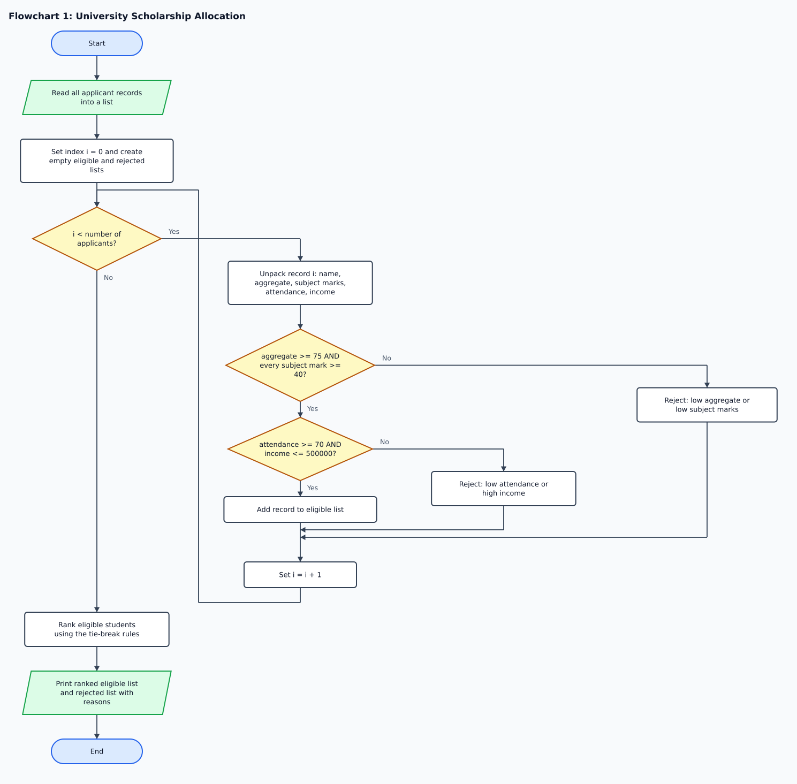
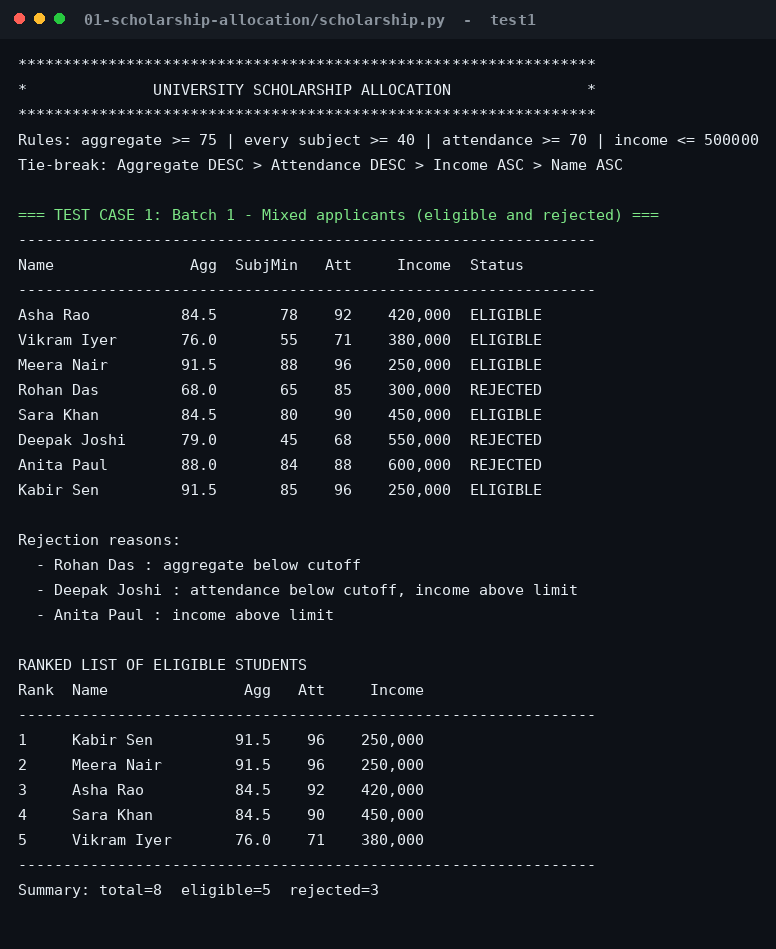
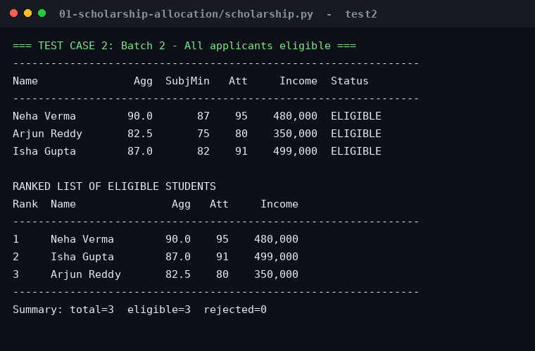
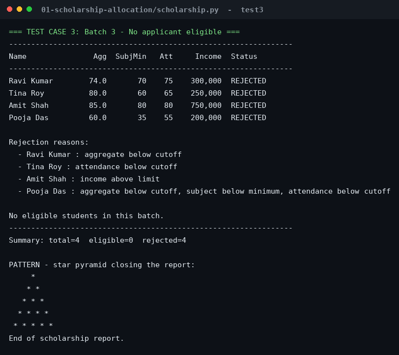

# Case Study 1 — University Scholarship Allocation

> **Syllabus used:** computational thinking · algorithms · flowcharts · pseudocode · variables · data types · operators · conditional statements · loops · strings · pattern generation · lists · nested lists · tuples · tuple operations · unpacking

## Deliverables Index

| # | Deliverable | Where to find it |
|---|-------------|------------------|
| 1 | Problem statement | [Section 1](#1-problem-statement) |
| 2 | Objectives | [Section 2](#2-objectives) |
| 3 | Assumptions | [Section 3](#3-assumptions) |
| 4 | Algorithm | [Section 4](#4-algorithm) |
| 5 | Flowchart | [Section 5](#5-flowchart) → [`flowchart.svg`](flowchart.svg) |
| 6 | Pseudocode | [Section 6](#6-pseudocode) |
| 7 | Python source code | [`scholarship.py`](scholarship.py) |
| 8 | Test cases | [Section 8](#8-test-cases) |
| 9 | Output screenshots | [Section 9](#9-output-screenshots) → `outputs/*.png` |
| 10 | Conclusion | [Section 10](#10-conclusion) |

---

## 1. Problem Statement

A university awards scholarships to meritorious students. The scholarship cell
receives a list of applicants, each with an **aggregate percentage**, **marks in
four subjects**, **attendance percentage** and **annual family income**. The cell
needs a system that:

1. evaluates every applicant against fixed eligibility rules
   (aggregate ≥ 75, every subject ≥ 40, attendance ≥ 70, family income ≤ ₹5,00,000),
2. separates eligible students from rejected ones and reports the **reason** for
   each rejection,
3. **ranks** the eligible students, and
4. resolves **ties** between students with equal aggregate marks using
   predefined rules: higher attendance wins; if attendance is also equal, lower
   family income wins; if still equal, the alphabetically earlier name wins.

## 2. Objectives

- Apply **computational thinking**: break the problem into *input → validate →
  classify → rank → output* sub-tasks.
- Use **variables and data types** (float, int, string) to store rules and records.
- Store each applicant as a **tuple** and the batch of applicants as a **list /
  nested list**; use **tuple unpacking** to read a record inside a loop.
- Apply **conditional statements** for eligibility and **nested loops** for
  ranking (count how many students are better than each student).
- Practise **string operations** (concatenation, f-string formatting) and
  **pattern generation** (banner borders and star pyramid).
- Produce a ranked scholarship list deterministically, including tie cases.

## 3. Assumptions

1. Aggregate marks are out of 100 and are supplied as a float (one decimal place).
2. Each applicant has exactly four subject marks (integer, 0–100).
3. Attendance is an integer percentage (0–100).
4. Family income is an annual figure in rupees (integer).
5. Eligibility thresholds: aggregate ≥ **75**, every subject ≥ **40**,
   attendance ≥ **70**, income ≤ **5,00,000**.
6. A student failing more than one rule is rejected once, but **all** violated
   rules are listed as the rejection reason.
7. Names are unique, so the final name-based tie-break always produces a strict
   total order (no shared ranks).
8. Test data are embedded in the program (three batches); no keyboard input is
   required, so runs are reproducible.
9. Ranking is 1-based: rank = 1 + (number of eligible students that rank better).

## 4. Algorithm

**Step 1 — Start.** Set the four rule constants (MIN_AGGREGATE = 75,
MIN_SUBJECT_MARK = 40, MIN_ATTENDANCE = 70, MAX_FAMILY_INCOME = 500000).

**Step 2 — Load test data.** Store three batches of applicants; each applicant is
a tuple `(name, aggregate, (m1, m2, m3, m4), attendance, income)`.

**Step 3 — For each batch (loop):**
1. Print the batch header (test-case marker + rule banner).
2. Create two empty lists: `eligible`, `rejected`.
3. **For each applicant tuple (loop with unpacking):**
   1. Scan the subject-marks tuple to find the **lowest** subject mark.
   2. Build a list of violated rules using conditionals (aggregate, subject,
      attendance, income).
   3. Concatenate the violated rules into a reason string (loop).
   4. **If** the reason list is empty → append
      `(aggregate, attendance, income, name, lowest)` to `eligible`.
      **Else** → append `(name, reason)` to `rejected`.
   5. Print one formatted table row with the status.
4. Print every rejection with its reason (loop over `rejected`).
5. **If** `eligible` is empty → print "No eligible students in this batch."
   **Else** — rank the list:
   1. For each eligible student `e`, unpack
      `(e_agg, e_att, e_inc, e_name, e_low)`.
   2. For every other eligible student `o`, unpack its tuple and test the
      tie-break cascade:
      `o_agg > e_agg` → better;
      else `o_agg = e_agg` and `o_att > e_att` → better;
      else aggregates **and** attendance equal and `o_inc < e_inc` → better;
      else all four equal and `o_name < e_name` → better.
   3. `rank(e) = 1 + count(better students)`.
   4. Print ranks 1 … n by scanning the rank list for each position.
6. Print the batch summary (total, eligible, rejected).

**Step 4 — Pattern.** Print a star pyramid (nested loops, string multiplication).

**Step 5 — End.**

## 5. Flowchart



*Legend:* blue stadium = start/end · green parallelogram = input/output ·
white rectangle = process · yellow diamond = decision. The loop on the right is
the per-applicant loop; the back-edge returns to the loop condition.

## 6. Pseudocode

```
BEGIN SCHOLARSHIP ALLOCATION

    SET min_agg     ← 75
    SET min_subject ← 40
    SET min_att     ← 70
    SET max_income  ← 500000

    SET batches ← list of (title, list of applicant tuples)

    PRINT banner using string multiplication and computed padding

    FOR each (batch_title, applicants) IN batches DO
        PRINT "=== TEST CASE n: batch_title ==="
        SET eligible ← empty list
        SET rejected ← empty list

        FOR each applicant IN applicants DO
            UNPACK applicant → name, aggregate, subjects, attendance, income

            SET lowest ← subjects[0]
            FOR each mark IN subjects DO
                IF mark < lowest THEN lowest ← mark
            END FOR

            SET parts ← empty list
            IF aggregate < min_agg     THEN append "aggregate below cutoff"
            IF lowest    < min_subject THEN append "subject below minimum"
            IF attendance< min_att     THEN append "attendance below cutoff"
            IF income    > max_income  THEN append "income above limit"

            SET reason ← join parts with ", " using a loop
            IF reason = "" THEN
                append (aggregate, attendance, income, name, lowest) to eligible
                status ← "ELIGIBLE"
            ELSE
                append (name, reason) to rejected
                status ← "REJECTED"
            END IF
            PRINT formatted row for the applicant
        END FOR

        FOR each (name, reason) IN rejected DO PRINT reason
        END FOR

        IF eligible is empty THEN
            PRINT "No eligible students in this batch."
        ELSE
            FOR each e IN eligible DO
                UNPACK e → e_agg, e_att, e_inc, e_name, e_low
                better ← 0
                FOR each o IN eligible DO
                    UNPACK o → o_agg, o_att, o_inc, o_name, o_low
                    IF o_agg > e_agg
                       OR (o_agg = e_agg AND o_att > e_att)
                       OR (o_agg = e_agg AND o_att = e_att AND o_inc < e_inc)
                       OR (o_agg = e_agg AND o_att = e_att AND o_inc = e_inc
                           AND o_name < e_name)
                    THEN better ← better + 1
                END FOR
                record rank = better + 1 for e
            END FOR
            FOR position ← 1 TO number of eligible students DO
                PRINT the student whose rank = position
            END FOR
        END IF
        PRINT batch summary
    END FOR

    PRINT star pyramid pattern
END SCHOLARSHIP ALLOCATION
```

## 7. Python Source Code

**File:** [`scholarship.py`](scholarship.py) — complete and runnable.

```bash
python3 scholarship.py
```

The program uses **only syllabus constructs**: variables, numeric/string data
types, comparison and logical operators, `if/elif/else`, `for` loops, strings
and f-string formatting, pattern generation with nested loops, lists, tuples,
tuple operations and unpacking. It contains **no functions, no dictionaries,
no imports and no file I/O**.

## 8. Test Cases

| ID | Scenario | Input summary | Expected result |
|----|----------|---------------|-----------------|
| TC1 | Mixed batch | 8 applicants: 5 pass, 3 fail; two full ties | 5 ranked **1 Kabir Sen, 2 Meera Nair, 3 Asha Rao, 4 Sara Khan, 5 Vikram Iyer**; 3 rejections with correct reasons |
| TC2 | All eligible | 3 applicants, all rules satisfied | Ranks **1 Neha Verma, 2 Isha Gupta, 3 Arjun Reddy**; 0 rejections |
| TC3 | None eligible | 4 applicants each failing ≥ 1 rule | Every row REJECTED; "No eligible students in this batch."; summary 0 eligible / 4 rejected |

**Detailed checks inside TC1**

| Applicant | Rule outcome | Verification |
|-----------|--------------|--------------|
| Kabir Sen (91.5, 96, ₹2,50,000) vs Meera Nair (91.5, 96, ₹2,50,000) | Full tie on aggregate, attendance **and** income | Name tie-break: *Kabir* < *Meera* → Kabir rank 1, Meera rank 2 |
| Asha Rao (84.5, 92) vs Sara Khan (84.5, 90) | Equal aggregate | Attendance 92 > 90 → Asha rank 3, Sara rank 4 |
| Rohan Das (68.0 aggregate) | 68 < 75 | Rejected — "aggregate below cutoff" |
| Deepak Joshi (attendance 68, income 5,50,000) | 68 < 70 **and** 5,50,000 > 5,00,000 | Rejected — **both** reasons listed |
| Anita Paul (income 6,00,000) | marks and attendance fine, income over limit | Rejected — "income above limit" |
| Vikram Iyer (76.0, subject min 55, attendance 71, ₹3,80,000) | All rules pass | Eligible, rank 5 (lowest aggregate among eligible) |

**Boundary values:** attendance exactly 70 passes (≥), income exactly 5,00,000
passes (≤), subject mark exactly 40 passes (≥) — verified by TC2's
Neha/Isha/Arjun records and rule definitions.

## 9. Output Screenshots

Captured by running `python3 scholarship.py` (full text log:
[`outputs/run_output.txt`](outputs/run_output.txt)).

**Test Case 1 — Mixed batch (eligibility table, rejection reasons, ranked list):**



**Test Case 2 — All applicants eligible:**



**Test Case 3 — No applicant eligible + closing star pattern:**



## 10. Conclusion

This case study demonstrates the complete problem-solving cycle described in the
syllabus: the problem was decomposed into **validation, classification and
ranking** phases (computational thinking), expressed as an algorithm, flowchart
and pseudocode, then implemented in Python using only fundamental constructs.

Key learnings:

- **Tuples + unpacking** give each applicant record a fixed, readable shape
  (`name, aggregate, subjects, attendance, income`), while a **list of tuples**
  holds the whole batch and a **nested list** groups the three test batches.
- **Nested loops** implement the O(n²) "count who is better" ranking, which
  encodes the four-level tie-break cascade (aggregate → attendance → income →
  name) without any sorting library.
- **Conditional cascades** with compound conditions (`and`) enforce all four
  eligibility rules, and list-append + loop concatenation collect *every*
  violated rule as the rejection reason.
- **String formatting and pattern generation** (banner borders, aligned tables,
  star pyramid) turn raw numbers into an auditable scholarship report.
- Three embedded test batches — mixed, all-pass and all-fail — exercise the
  normal path, the tie-break path and the empty-eligible path, confirming the
  design is correct and reproducible.
