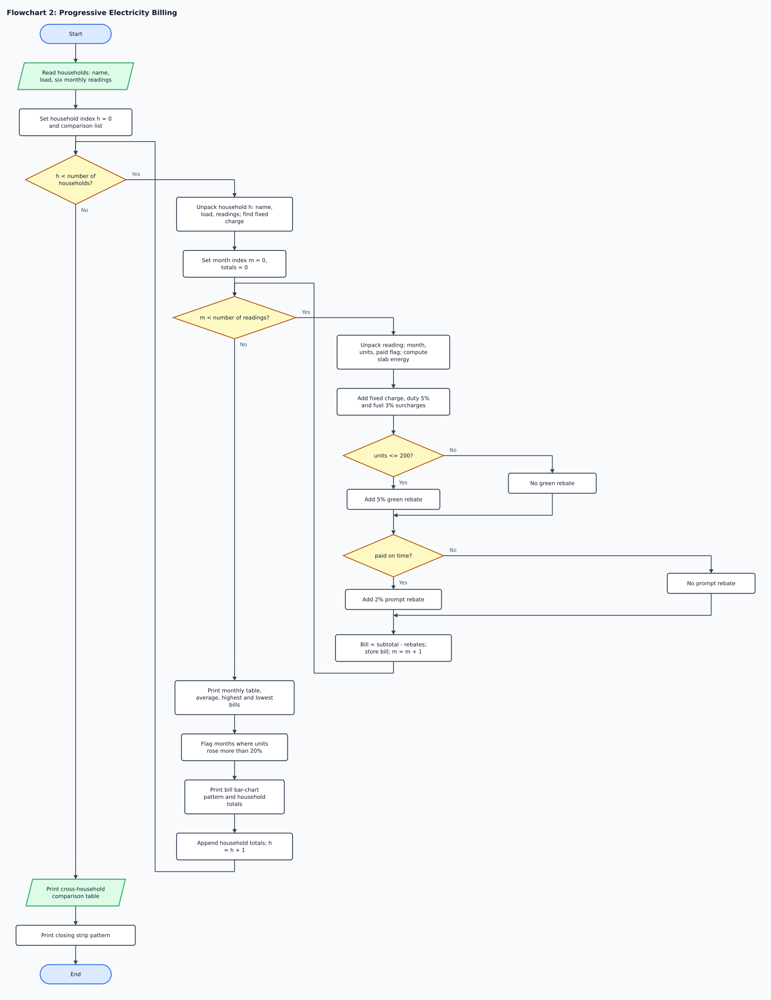
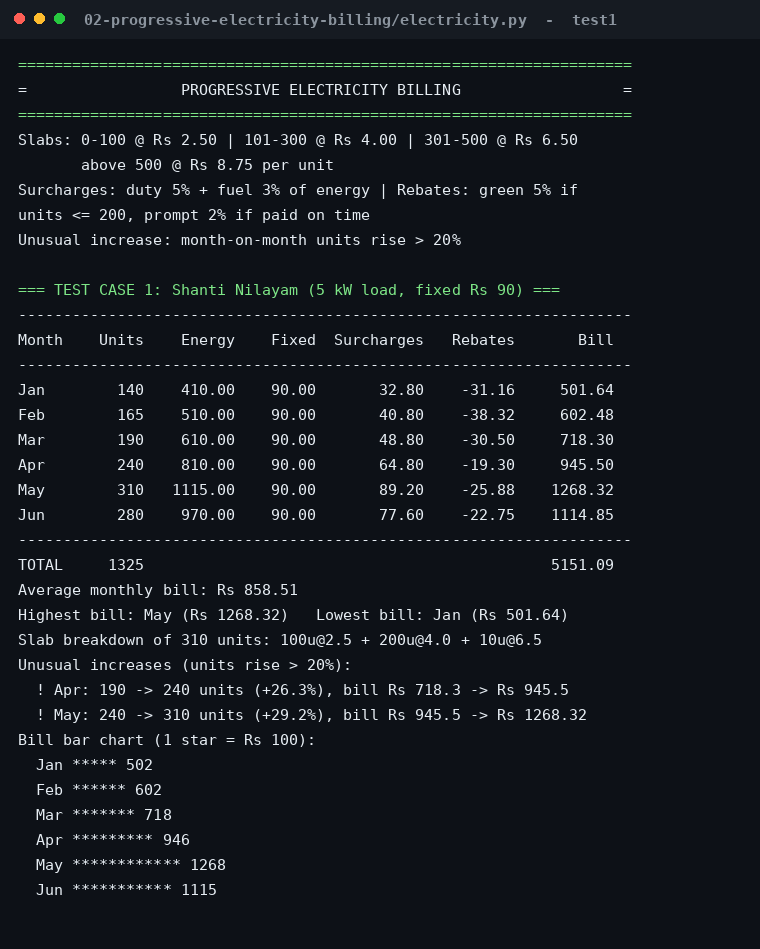
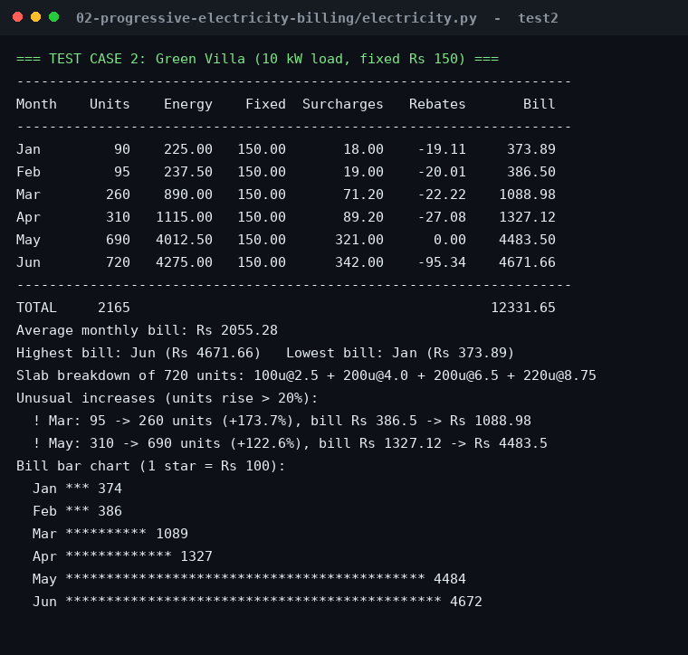
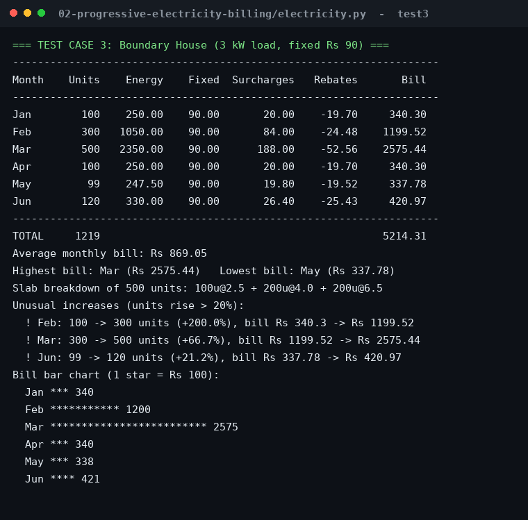

# Case Study 2 — Progressive Electricity Billing

> **Syllabus used:** computational thinking · algorithms · flowcharts · pseudocode · variables · data types · operators · conditional statements · loops · strings · pattern generation · lists · nested lists · tuples · tuple operations · unpacking

## Deliverables Index

| # | Deliverable | Where to find it |
|---|-------------|------------------|
| 1 | Problem statement | [Section 1](#1-problem-statement) |
| 2 | Objectives | [Section 2](#2-objectives) |
| 3 | Assumptions | [Section 3](#3-assumptions) |
| 4 | Algorithm | [Section 4](#4-algorithm) |
| 5 | Flowchart | [Section 5](#5-flowchart) → [`flowchart.svg`](flowchart.svg) |
| 6 | Pseudocode | [Section 6](#6-pseudocode) |
| 7 | Python source code | [`electricity.py`](electricity.py) |
| 8 | Test cases | [Section 8](#8-test-cases) |
| 9 | Output screenshots | [Section 9](#9-output-screenshots) → `outputs/*.png` |
| 10 | Conclusion | [Section 10](#10-conclusion) |

---

## 1. Problem Statement

A power distribution company bills household consumers on a **progressive slab
tariff**. For every consumer the system must:

1. compute the **energy charge** by splitting consumption across slabs
   (0–100 @ ₹2.50, 101–300 @ ₹4.00, 301–500 @ ₹6.50, above 500 @ ₹8.75 per unit),
2. add a **fixed charge** based on connected load (≤ 5 kW → ₹90, ≤ 10 kW →
   ₹150, otherwise ₹260),
3. add **surcharges** — electricity duty 5 % and fuel-adjustment 3 % of the
   energy charge,
4. allow **rebates** — a 5 % "green" rebate on energy when consumption ≤ 200
   units, and a 2 % prompt-payment rebate on the subtotal when the bill is paid
   on time,
5. compare the six monthly bills of each household, report average / highest /
   lowest bills, and **flag unusual increases** (month-on-month unit rise
   greater than 20 %), and
6. compare all households against each other.

## 2. Objectives

- Model tariffs as a **nested list of slab tuples** and apply them with a loop
  (progressive calculation, not a flat rate).
- Practise **tuple unpacking** for `(upper_limit, rate)`, `(month, units, paid)`
  and `(max_kW, fixed)` records.
- Use **compound conditionals** for rebate eligibility and the unusual-increase
  test; use `break` inside loops for early exit.
- Accumulate running totals (units, bills) with **assignment operators** and
  round money with `round()`.
- Produce aligned financial tables with **f-string formatting** and a
  **bar-chart pattern** made from `"*"` strings (pattern generation).

## 3. Assumptions

1. Slab limits are cumulative upper bounds: a consumer pays ₹2.50 for the first
   100 units, ₹4.00 only for units 101–300, ₹6.50 only for 301–500, and ₹8.75
   for every unit beyond 500.
2. Fixed charge depends only on connected load: ≤ 5 kW → ₹90, ≤ 10 kW → ₹150,
   anything higher → ₹260.
3. Electricity duty = 5 % and fuel adjustment = 3 % of the **energy charge**
   (not of the fixed charge).
4. Green rebate = 5 % of energy charge when the month's units ≤ 200 (independent
   of payment behaviour).
5. Prompt-payment rebate = 2 % of (energy + fixed + surcharges) when the reading
   carries a "paid on time" flag.
6. Bill = energy + fixed + surcharges − all rebates, rounded to 2 decimal
   places; annual totals are the sum of the rounded monthly bills.
7. A month-on-month **unit** rise strictly greater than 20 % is "unusual"; the
   first month of a household has no predecessor and is never flagged.
8. Every household has exactly six readings (Jan–Jun); units ≥ 1 so percentage
   change is always defined.
9. All test data are embedded; runs are deterministic and reproducible.

## 4. Algorithm

**Step 1 — Start.** Store the slab table `[(limit, rate), …]`, load-charge
table `[(max_kW, charge), …]`, rate constants (duty 0.05, fuel 0.03, green 0.05,
prompt 0.02, unusual 20 %) and the household test data (nested list of
`(name, load, [(month, units, paid), …])`).

**Step 2 — For each household (outer loop):**
1. Scan the load table to find the fixed charge for the household's load.
2. Print the test-case header.
3. **For each monthly reading (inner loop, tuple unpacking):**
   1. Walk the slab table with a running `remaining` counter, charging only the
      units that fall inside each slab; stop when units are exhausted (`break`).
   2. Compute duty and fuel surcharges; form the subtotal.
   3. **If** units ≤ 200 → add the 5 % green rebate.
   4. **If** paid on time → add the 2 % prompt rebate.
   5. `bill = round(subtotal − rebates, 2)`; append the month's tuple to the
      `bills` list; update running totals.
4. Print the monthly comparison table (units, energy, fixed, surcharges,
   rebates, bill) plus totals and average.
5. Scan `bills` once to locate the highest and lowest bill months.
6. Re-walk the slab table for the highest-usage month to print the slab
   breakdown (e.g. `100u@2.5 + 200u@4.0 + 10u@6.5`).
7. Compare every month with its predecessor: if
   `(units − prev_units) × 100 / prev_units > 20` → flag the unusual increase
   with both the unit and rupee change.
8. Print a **bar-chart pattern** (1 star ≈ ₹100) for the six bills.
9. Append `(household name, total units, total bill)` to `all_totals`.

**Step 3 — Cross-household comparison.** Print a summary table of total units,
total bill and average bill for every household.

**Step 4 — Pattern.** Print an alternating `=` / `-` closing strip.

**Step 5 — End.**

## 5. Flowchart



*Legend:* blue stadium = start/end · green parallelogram = input/output ·
white rectangle = process · yellow diamond = decision. Two nested loops are
shown: the outer loop walks the households, the inner loop walks the six
monthly readings; both return to their condition boxes through back-edges.

## 6. Pseudocode

```
BEGIN ELECTRICITY BILLING

    SET slabs   ← [(100, 2.50), (300, 4.00), (500, 6.50), (999999, 8.75)]
    SET loads   ← [(5, 90), (10, 150), (9999, 260)]
    SET duty_rate ← 0.05 , fuel_rate ← 0.03
    SET green_rate ← 0.05 , green_limit ← 200
    SET prompt_rate ← 0.02 , unusual_pct ← 20

    FOR each (hh_name, load_kw, readings) IN households DO
        SET fixed ← charge from loads where load_kw <= max_kw
        PRINT test-case header
        SET bills ← empty list , total_units ← 0 , total_bill ← 0

        FOR each (month, units, paid) IN readings DO
            SET remaining ← units , energy ← 0 , prev_limit ← 0
            FOR each (limit, rate) IN slabs DO
                SET span ← limit - prev_limit
                SET take ← min(remaining, span)
                IF take > 0 THEN
                    energy ← energy + take * rate
                    remaining ← remaining - take
                END IF
                prev_limit ← limit
                IF remaining <= 0 THEN BREAK
            END FOR

            SET surcharge ← energy * duty_rate + energy * fuel_rate
            SET subtotal ← energy + fixed + surcharge
            SET rebate ← 0
            IF units <= green_limit THEN rebate ← rebate + energy * green_rate
            IF paid THEN rebate ← rebate + subtotal * prompt_rate
            SET bill ← round(subtotal - rebate, 2)
            append (month, units, energy, surcharge, rebate, bill) to bills
            total_units ← total_units + units
            total_bill  ← total_bill + bill
        END FOR

        PRINT table row for every month, totals, average
        FIND highest and lowest bill by scanning bills
        REWALK slabs for max-usage month and PRINT breakdown
        FOR i ← 1 TO len(bills) - 1 DO
            rise ← (bills[i].units - bills[i-1].units) * 100 / bills[i-1].units
            IF rise > unusual_pct THEN PRINT warning
        END FOR
        PRINT bar-chart pattern (1 star = Rs 100)
        append (hh_name, total_units, total_bill) to all_totals
    END FOR

    PRINT cross-household comparison table
    PRINT closing strip pattern
END ELECTRICITY BILLING
```

## 7. Python Source Code

**File:** [`electricity.py`](electricity.py) — complete and runnable.

```bash
python3 electricity.py
```

Only syllabus constructs are used: variables, numeric/string/bool data types,
arithmetic and comparison operators, `if/elif/else`, `for` loops with `break`,
strings and f-strings, pattern generation, lists, nested lists, tuples,
tuple operations and unpacking — **no functions, no dictionaries, no imports,
no file I/O**.

## 8. Test Cases

| ID | Scenario | Input summary | Expected result |
|----|----------|---------------|-----------------|
| TC1 | Moderate household, mixed payment behaviour | Shanti Nilayam, 5 kW, units 140→165→190→240→310→280; Mar paid late | Jan bill **₹501.64**; two unusual increases (**Apr +26.3 %**, **May +29.2 %**); total ₹5,151.09; average ₹858.51; highest May ₹1,268.32; slab breakdown of 310 u = `100u@2.5 + 200u@4.0 + 10u@6.5` |
| TC2 | High-load household crossing every slab | Green Villa, 10 kW, units 90→95→260→310→690→720; May paid late | Fixed charge ₹150; unusual increases **Mar +173.7 %** and **May +122.6 %**; May has **no rebate at all** (690 > 200 units *and* late payment) → bill ₹4,483.50 exactly; total ₹12,331.65; 720-unit breakdown uses all four slabs |
| TC3 | Exact slab boundaries | Boundary House, 3 kW, units **100, 300, 500**, 100, 99, 120 — all paid on time | Jan = ₹340.30 (100 u × 2.50, green + prompt rebates); Feb ₹1,199.52; Mar ₹2,575.44 (energy 100×2.5 + 200×4 + 200×6.5 = ₹2,350); unusual **Feb +200 %**, **Mar +66.7 %**, **Jun +21.2 %** (99→120 just over the 20 % line) |

**Hand-verification of the tariff math (TC3, January):**

| Component | Computation | Value |
|-----------|-------------|-------|
| Energy | 100 × 2.50 | 250.00 |
| Fixed | 3 kW ≤ 5 kW | 90.00 |
| Duty + fuel | 8 % × 250 | 20.00 |
| Subtotal | 250 + 90 + 20 | 360.00 |
| Green rebate | 5 % × 250 (100 ≤ 200) | −12.50 |
| Prompt rebate | 2 % × 360 (paid on time) | −7.20 |
| **Bill** | 360 − 19.70 | **340.30 ✓** |

Boundary semantics verified: units = 200 *qualifies* for the green rebate
(≤), units = 201 does not; the unusual test is *strictly* greater than 20 %
(Jun's 99 → 120 = +21.2 % is flagged, a hypothetical +20.0 % would not be).

## 9. Output Screenshots

Captured by running `python3 electricity.py` (full text log:
[`outputs/run_output.txt`](outputs/run_output.txt)).

**Test Case 1 — Moderate household: tables, unusual-increase flags, bar chart:**



**Test Case 2 — High-load household with all-slab consumption:**



**Test Case 3 — Slab-boundary household + cross-household comparison:**



## 10. Conclusion

The billing system shows how **progressive (multi-slab) pricing** falls out of
a simple loop over a nested list of `(limit, rate)` tuples: each iteration
consumes only the units that belong to its slab, so the same three lines of
logic handle 99 units or 9,999 units.

Key learnings:

- **Nested lists of tuples** express tariff tables and household records
  compactly; **unpacking** (`for limit, rate in SLABS`, `for month, units,
  paid in readings`) keeps the loop body readable.
- **Nested loops** (households → months) produce the monthly comparison, and a
  second independent scan detects **unusual increases** by comparing each
  element with its predecessor — list indexing and `range()` working together.
- **Conditional layers** (slab selection, load-based fixed charge, two
  independent rebate rules, percentage-threshold anomaly test) demonstrate how
  operators (`<=`, `>`, `*`, `//`) and boolean logic encode a real tariff
  contract precisely, including its boundary cases.
- **Money formatting and pattern generation** (aligned columns, `round()` to
  two decimals, the `*`-bar chart, the alternating closing strip) turn raw
  calculations into a consumer-readable statement.
- Three test households — moderate, high-load and exact-boundary — confirm the
  implementation against hand-computed reference bills (₹501.64, ₹340.30,
  ₹2,575.44) and exercise every rebate and anomaly rule.
