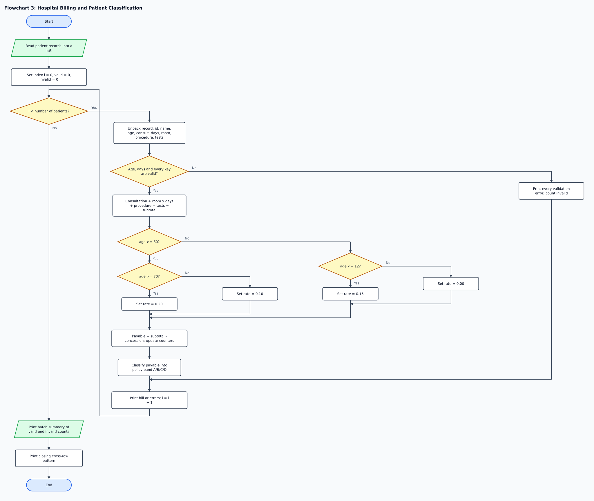
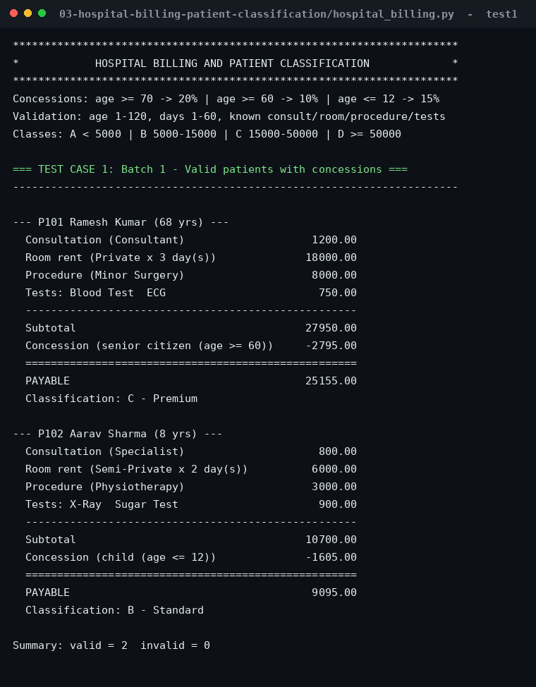
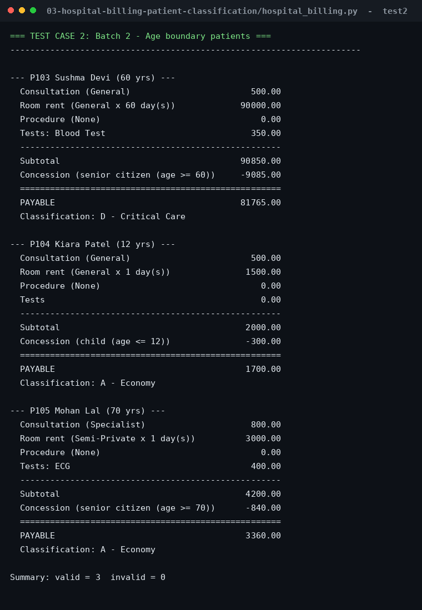
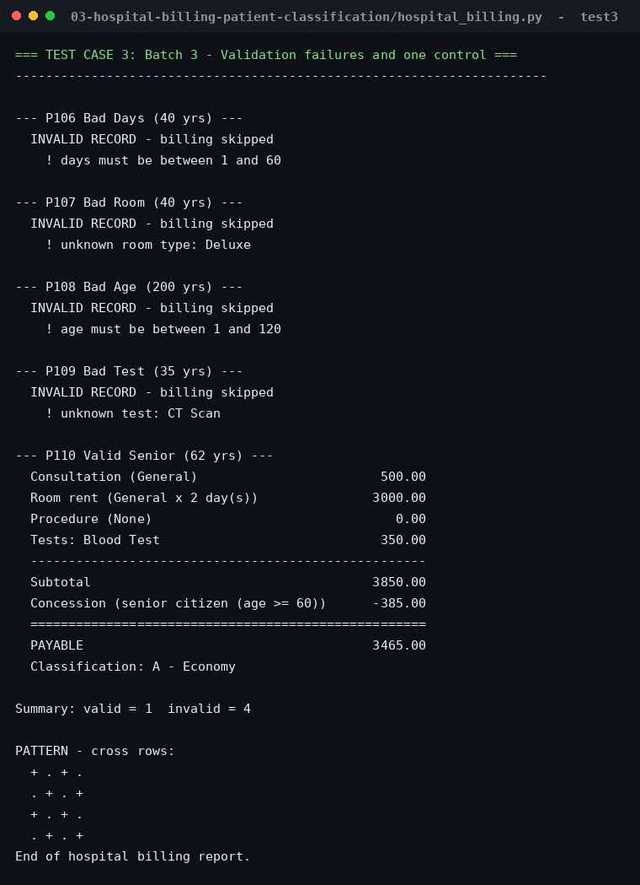

# Case Study 3 — Hospital Billing and Patient Classification

> **Syllabus used:** computational thinking · algorithms · flowcharts · pseudocode · variables · data types · operators · conditional statements · loops · strings · pattern generation · lists · nested lists · tuples · tuple operations · unpacking

## Deliverables Index

| # | Deliverable | Where to find it |
|---|-------------|------------------|
| 1 | Problem statement | [Section 1](#1-problem-statement) |
| 2 | Objectives | [Section 2](#2-objectives) |
| 3 | Assumptions | [Section 3](#3-assumptions) |
| 4 | Algorithm | [Section 4](#4-algorithm) |
| 5 | Flowchart | [Section 5](#5-flowchart) → [`flowchart.svg`](flowchart.svg) |
| 6 | Pseudocode | [Section 6](#6-pseudocode) |
| 7 | Python source code | [`hospital_billing.py`](hospital_billing.py) |
| 8 | Test cases | [Section 8](#8-test-cases) |
| 9 | Output screenshots | [Section 9](#9-output-screenshots) → `outputs/*.png` |
| 10 | Conclusion | [Section 10](#10-conclusion) |

---

## 1. Problem Statement

A hospital must generate a bill for every admitted patient and place the
patient in a payment class. Each patient record contains an ID, name, age,
consultation type, length of stay (days), room type, an optional procedure and
a list of diagnostic tests. The system must:

1. **validate** the record — age must be 1–120, days 1–60, and every
   consultation type, room type, procedure and test must exist in the supplied
   charge tables; invalid records are reported with *all* violation messages
   and are not billed,
2. **compute the bill** — consultation fee + (room rent × days) + procedure
   fee + the sum of the ordered tests,
3. **apply a conditional concession** on the subtotal:
   age ≥ 70 → 20 %, age ≥ 60 → 10 %, age ≤ 12 → 15 %, otherwise none,
4. **classify** the final payable amount using the supplied payment policy
   (A < 5,000 · B 5,000–15,000 · C 15,000–50,000 · D ≥ 50,000), and
5. print an itemised statement plus batch summaries of valid/invalid counts.

## 2. Objectives

- Practise **computational thinking**: decompose the task into
  *validate → charge → concede → classify → report*.
- Store charge tables and the payment policy as **nested lists of tuples**
  and search them with loops (linear search instead of dictionaries).
- Use **tuple unpacking** to read `(pid, name, age, …, tests)` records and
  `(min, max, class)` policy bands.
- Combine **conditional statements** (`if/elif/else`) for the concession
  ladder and compound validation conditions (`or`, `and`, `not`).
- Use **lists** to collect *all* validation errors before deciding, and
  **counters** updated with assignment operators.
- Format an aligned itemised bill with **f-strings** and close with a
  **checkerboard pattern** (pattern generation).

## 3. Assumptions

1. Consultation fees: General ₹500, Specialist ₹800, Consultant ₹1,200.
2. Room rent per day: General ₹1,500, Semi-Private ₹3,000, Private ₹6,000.
3. Test prices: Blood Test ₹350, X-Ray ₹700, MRI ₹2,500, ECG ₹400,
   Sugar Test ₹200, Ultrasound ₹900.
4. Procedures: None ₹0, Minor Surgery ₹8,000, Major Surgery ₹25,000,
   Physiotherapy ₹3,000 (charged once per admission).
5. Concessions apply to the **whole subtotal** and are decided by age only:
   ≥ 70 → 20 %, else ≥ 60 → 10 %, else ≤ 12 → 15 %, else 0 %.
   The `elif` order guarantees a patient receives exactly one rate.
6. Validation limits: age 1–120 (inclusive), days 1–60 (inclusive); unknown
   keys produce one error message each; an invalid patient is never billed.
7. Payment-policy bands are half-open: `min ≤ payable < max`, so a payable of
   exactly ₹5,000 falls in class B.
8. Money is rounded to 2 decimals only at the concession/payable stage;
   charges are exact rupee integers.
9. Test data are embedded in three batches; runs are deterministic.

## 4. Algorithm

**Step 1 — Start.** Store the four charge tables, the class policy bands and
the validation/concession constants.

**Step 2 — For each batch (outer loop):** reset `valid` and `invalid`
counters.

**Step 3 — For each patient tuple (loop with unpacking):**
1. Create an empty `errors` list.
2. Range-check age and days (`or` conditions).
3. Search `CONSULTATIONS` for the consultation key; if absent append an error.
4. Search `ROOM_RENTS` for the room key; if absent append an error.
5. Search `PROCEDURES` for the procedure key; if absent append an error.
6. For each test in the patient's test list, search `TEST_PRICES`; unknown
   tests append an error, known tests add to `test_total`.
7. **If** `errors` is non-empty → print "INVALID RECORD", print every error,
   increment `invalid`, and skip to the next patient (`continue`).
8. **Else** (valid):
   1. `room_total = room_rate × days`,
      `subtotal = consult + room_total + procedure + test_total`.
   2. Concession ladder with `if/elif/else` → `rate` and `reason`.
   3. `concession = round(subtotal × rate, 2)`,
      `payable = round(subtotal − concession, 2)`.
   4. Print the itemised bill (consultation, room, procedure, tests,
      subtotal, concession, payable) in aligned columns.
   3. Classify: scan `CLASS_POLICY` bands; the band satisfying
      `payable ≥ min and payable < max` gives the class label.
   4. Print the classification; increment `valid`.

**Step 4 —** Print the batch summary (valid/invalid counts).

**Step 5 —** Print a checkerboard `+`/`.` pattern (nested loops).

**Step 6 — End.**

## 5. Flowchart



*Legend:* blue stadium = start/end · green parallelogram = input/output ·
white rectangle = process · yellow diamond = decision. The validation decision
branches right for error reporting and rejoins the main flow; the concession
ladder is a chain of nested decisions (age ≥ 60 → age ≥ 70 / age ≤ 12).

## 6. Pseudocode

```
BEGIN HOSPITAL BILLING AND CLASSIFICATION

    SET consultations ← [(General, 500), (Specialist, 800), (Consultant, 1200)]
    SET rooms         ← [(General, 1500), (Semi-Private, 3000), (Private, 6000)]
    SET tests         ← [(Blood Test, 350), ... , (Ultrasound, 900)]
    SET procedures    ← [(None, 0), (Minor Surgery, 8000), ...]
    SET policy        ← [(0, 5000, A), (5000, 15000, B),
                         (15000, 50000, C), (50000, 99999999, D)]

    FOR each (title, patients) IN batches DO
        valid ← 0 , invalid ← 0
        FOR each patient IN patients DO
            UNPACK patient → pid, name, age, consult, days, room, procedure, tests
            errors ← empty list

            IF age < 1 OR age > 120       THEN append "age out of range"
            IF days < 1 OR days > 60      THEN append "days out of range"
            IF consult NOT IN consultations THEN append "unknown consultation"
            IF room NOT IN rooms          THEN append "unknown room"
            IF procedure NOT IN procedures  THEN append "unknown procedure"
            FOR each t IN tests DO
                IF t NOT IN tests table THEN append "unknown test"
                ELSE test_total ← test_total + price(t)
            END FOR

            IF errors NOT empty THEN
                PRINT "INVALID RECORD"; print every error
                invalid ← invalid + 1
                CONTINUE to next patient
            END IF

            room_total ← room_rate * days
            subtotal ← consult_fee + room_total + procedure_fee + test_total

            rate ← 0
            IF age >= 70        THEN rate ← 0.20
            ELSE IF age >= 60   THEN rate ← 0.10
            ELSE IF age <= 12   THEN rate ← 0.15

            concession ← round(subtotal * rate, 2)
            payable   ← round(subtotal - concession, 2)
            PRINT itemised bill
            FOR each (cmin, cmax, cname) IN policy DO
                IF payable >= cmin AND payable < cmax THEN class ← cname
            END FOR
            PRINT class
            valid ← valid + 1
        END FOR
        PRINT "valid = ... invalid = ..."
    END FOR

    PRINT checkerboard pattern
END HOSPITAL BILLING AND CLASSIFICATION
```

## 7. Python Source Code

**File:** [`hospital_billing.py`](hospital_billing.py) — complete and runnable.

```bash
python3 hospital_billing.py
```

Only syllabus constructs are used: variables, data types (int, float, string,
list, tuple), operators, `if/elif/else`, `for` loops, `continue`, strings and
f-strings, pattern generation, lists, nested lists, tuples, tuple operations
and unpacking — **no functions, no dictionaries, no imports, no file I/O**.

## 8. Test Cases

| ID | Scenario | Input summary | Expected result |
|----|----------|---------------|-----------------|
| TC1 | Two valid patients with concessions | P101 (68 y, Consultant, 3 d Private, Minor Surgery, Blood Test + ECG); P102 (8 y, Specialist, 2 d Semi-Private, Physiotherapy, X-Ray + Sugar Test) | P101 subtotal ₹27,950 → 10 % → **PAYABLE ₹25,155 → class C**; P102 subtotal ₹10,700 → 15 % → **PAYABLE ₹9,095 → class B**; summary valid 2 / invalid 0 |
| TC2 | Age and stay boundaries | P103 (exactly 60 y, exactly 60 days); P104 (exactly 12 y, no tests); P105 (exactly 70 y) | P103 ₹90,850 → 10 % → **₹81,765 → class D**; P104 ₹2,000 → 15 % → **₹1,700 → class A**; P105 ₹4,200 → 20 % → **₹3,360 → class A**; summary valid 3 / invalid 0 |
| TC3 | Validation failures + control | P106 days = 0; P107 room "Deluxe"; P108 age 200; P109 test "CT Scan"; P110 valid 62 y control | Four INVALID records, each with its exact error message and **no bill**; P110 billed ₹3,850 → 10 % → **₹3,465 → class A**; summary valid 1 / invalid 4 |

**Hand-verification of P101:**

| Component | Computation | Value |
|-----------|-------------|-------|
| Consultation | Consultant | 1,200.00 |
| Room | ₹6,000 × 3 days | 18,000.00 |
| Procedure | Minor Surgery | 8,000.00 |
| Tests | Blood 350 + ECG 400 | 750.00 |
| Subtotal | sum | 27,950.00 |
| Concession | 10 % (age 68 ≥ 60, < 70) | −2,795.00 |
| **Payable** | 27,950 − 2,795 | **25,155.00 ✓** |
| Class | 15,000 ≤ 25,155 < 50,000 | **C - Premium ✓** |

**Boundary semantics verified:** age 60 receives the senior rate but not the
super-senior rate (≥ 70 checked first); age 12 still qualifies as a child
(≤ 12) while age 13 would receive no concession; days 60 is accepted and
days 61 rejected; a payable of exactly ₹5,000 would fall in class B
(`≥ min` of B, `< max` of A fails).

## 9. Output Screenshots

Captured by running `python3 hospital_billing.py` (full text log:
[`outputs/run_output.txt`](outputs/run_output.txt)).

**Test Case 1 — Valid patients, itemised bills, concessions, classes:**



**Test Case 2 — Age-boundary patients (60 / 12 / 70):**



**Test Case 3 — Validation failures with exact error messages + control:**



## 10. Conclusion

This case study combined **validation logic, arithmetic billing and
classification** in one pipeline, showing how a real-world admission process
maps onto syllabus constructs.

Key learnings:

- **Nested lists of tuples** act as small databases (charge tables, policy
  bands); loops perform linear search — the same idea dictionaries implement,
  expressed with `for` + `if`.
- **Tuple unpacking** (`for pid, name, age, … in patients`) lets the loop body
  work with meaningful names, while the patient's test list nested *inside*
  the tuple demonstrates nested data structures.
- **Accumulating errors in a list** before deciding keeps validation
  complete (a record can fail several rules at once) and demonstrates
  list-append + length-check control flow with `continue`.
- The **concession ladder** is a classic `if/elif/else` chain: order matters,
  because the ≥ 70 test must precede ≥ 60, and exactly one rate is assigned.
- **Half-open interval matching** (`min ≤ payable < max`) against the payment
  policy gives deterministic classification at band edges.
- Itemised formatting with fixed-width f-strings plus the closing
  checkerboard pattern reinforce **strings and pattern generation**.
- Five patients across three batches exercised every path: normal billing,
  all three concession rates, four distinct validation failures and the
  empty-test-list case — all outputs match hand-computed values.
