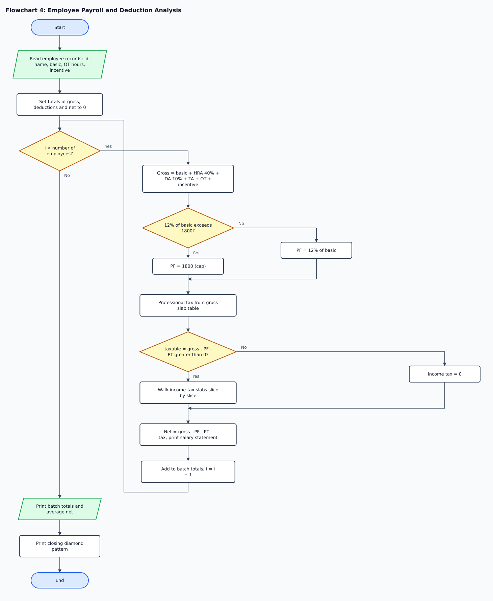
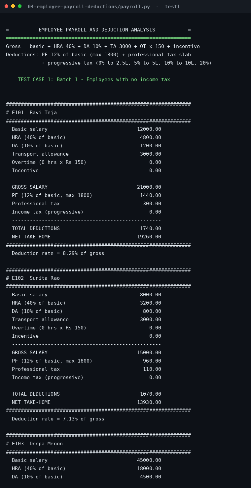
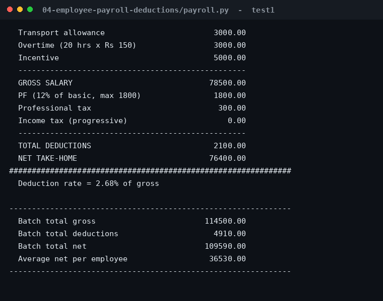
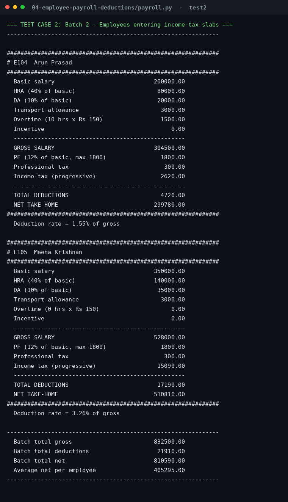
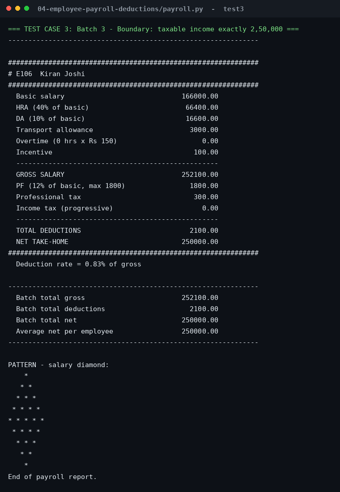

# Case Study 4 — Employee Payroll and Deduction Analysis

> **Syllabus used:** computational thinking · algorithms · flowcharts · pseudocode · variables · data types · operators · conditional statements · loops · strings · pattern generation · lists · nested lists · tuples · tuple operations · unpacking

## Deliverables Index

| # | Deliverable | Where to find it |
|---|-------------|------------------|
| 1 | Problem statement | [Section 1](#1-problem-statement) |
| 2 | Objectives | [Section 2](#2-objectives) |
| 3 | Assumptions | [Section 3](#3-assumptions) |
| 4 | Algorithm | [Section 4](#4-algorithm) |
| 5 | Flowchart | [Section 5](#5-flowchart) → [`flowchart.svg`](flowchart.svg) |
| 6 | Pseudocode | [Section 6](#6-pseudocode) |
| 7 | Python source code | [`payroll.py`](payroll.py) |
| 8 | Test cases | [Section 8](#8-test-cases) |
| 9 | Output screenshots | [Section 9](#9-output-screenshots) → `outputs/*.png` |
| 10 | Conclusion | [Section 10](#10-conclusion) |

---

## 1. Problem Statement

A company must prepare monthly salary statements for its employees. For each
employee — given **basic pay, overtime hours and incentive** — the payroll
system must:

1. compute **gross salary** = basic + HRA (40 % of basic) + DA (10 % of
   basic) + fixed transport allowance ₹3,000 + overtime (hours × ₹150) +
   incentive,
2. apply **progressive deductions**:
   - Provident Fund = 12 % of basic, **capped at ₹1,800**,
   - Professional tax from a gross-based slab table
     (≤ 10,000 → ₹0 · ≤ 15,000 → ₹110 · ≤ 20,000 → ₹200 · above → ₹300),
   - **Income tax** computed slice-by-slice on
     `taxable = gross − PF − professional tax` using progressive slabs
     (first ₹2,50,000 nil · next ₹2,50,000 @ 5 % · next ₹5,00,000 @ 10 % ·
     remainder @ 20 %),
3. produce a **formatted salary statement** with every earning and deduction,
   the net take-home and the effective deduction rate, and
4. aggregate batch totals and averages across employees.

## 2. Objectives

- Model earning heads as **variables** and deduction rules as **slab tables**
  (lists of tuples) applied by loops.
- Practise **tuple unpacking** over nested lists of employee tuples.
- Use a **conditional cap** (`if pf > 1800`) and an `if`-chain slab lookup for
  professional tax.
- Implement **progressive (marginal) tax** with the same "walk the slabs
  slice by slice" loop pattern used for slab tariffs — reinforcing loops,
  `break` and assignment operators.
- Produce an **aligned statement** with f-strings and close with a
  **diamond star pattern** (pattern generation).

## 3. Assumptions

1. HRA = 40 % of basic; DA = 10 % of basic; transport allowance = ₹3,000 flat;
   overtime = ₹150 per hour; incentive is a flat rupee amount.
2. PF = 12 % of basic but never more than ₹1,800 (wage-ceiling cap).
3. Professional tax depends only on gross: ≤ 10,000 → ₹0, ≤ 15,000 → ₹110,
   ≤ 20,000 → ₹200, otherwise ₹300 (first matching upper bound wins).
4. Taxable income = gross − PF − professional tax; no other exemptions.
5. Income tax slabs are cumulative: 0 % up to ₹2,50,000, 5 % on the slice
   ₹2,50,001–5,00,000, 10 % on ₹5,00,001–10,00,000, 20 % above ₹10,00,000.
   Each rupee is taxed in at most one slab (marginal, not flat).
6. All money values are rounded to 2 decimals at the deduction/net stage;
   earnings are exact.
7. Deduction rate % = total deductions × 100 / gross, rounded to 2 decimals.
8. Test data (three batches of employees) are embedded; runs are
   deterministic. Basic pay is always > 0 so gross is always defined.

## 4. Algorithm

**Step 1 — Start.** Store allowances/cap constants, the professional-tax slab
table and the progressive tax-slab table; store three batches of
`(emp_id, name, basic, ot_hours, incentive)` tuples.

**Step 2 — For each batch (outer loop):** reset `sum_gross`,
`sum_deductions`, `sum_net`.

**Step 3 — For each employee (loop with unpacking):**
1. `hra = 0.40 × basic`, `da = 0.10 × basic`, `ot_pay = ot_hours × 150`.
2. `gross = basic + hra + da + 3000 + ot_pay + incentive`.
3. `pf = 0.12 × basic`; **if** `pf > 1800` then `pf = 1800` (cap).
4. Scan the professional-tax table; the first `gross ≤ limit` gives `pt`
   (`break`).
5. `taxable = gross − pf − pt`.
6. **If** `taxable > 0`, walk the tax slabs: for each `(limit, rate)`, take
   `slice = min(remaining, limit − previous_limit)`, add `slice × rate` to
   the tax, subtract from `remaining`, stop when nothing remains.
7. `total_deductions = pf + pt + tax`; `net = gross − total_deductions`.
8. Print the formatted statement (`#` banner, earning lines, GROSS, deduction
   lines, TOTAL DEDUCTIONS, NET TAKE-HOME, deduction rate %).
9. Add gross/deductions/net to the batch sums.

**Step 4 —** Print batch totals and average net per employee.

**Step 5 —** Print a star **diamond pattern** (up-half then down-half loops).

**Step 6 — End.**

## 5. Flowchart



*Legend:* blue stadium = start/end · green parallelogram = input/output ·
white rectangle = process · yellow diamond = decision. The loop processes one
employee per pass; the two side decisions implement the PF cap and the
"any taxable income?" test before the slab walk.

## 6. Pseudocode

```
BEGIN PAYROLL

    SET hra_rate ← 0.40 , da_rate ← 0.10 , ta ← 3000 , ot_rate ← 150
    SET pf_rate ← 0.12 , max_pf ← 1800
    SET pt_slabs  ← [(10000,0), (15000,110), (20000,200), (99999999,300)]
    SET tax_slabs ← [(250000,0.00), (500000,0.05),
                     (1000000,0.10), (99999999,0.20)]

    FOR each (title, employees) IN batches DO
        sum_gross ← 0 , sum_deductions ← 0 , sum_net ← 0
        FOR each employee IN employees DO
            UNPACK employee → emp_id, name, basic, ot_hours, incentive
            hra ← basic * hra_rate
            da  ← basic * da_rate
            ot_pay ← ot_hours * ot_rate
            gross ← basic + hra + da + ta + ot_pay + incentive

            pf ← basic * pf_rate
            IF pf > max_pf THEN pf ← max_pf

            pt ← 0
            FOR each (limit, charge) IN pt_slabs DO
                IF gross <= limit THEN pt ← charge ; BREAK
            END FOR

            taxable ← gross - pf - pt
            tax ← 0 , remaining ← taxable , prev ← 0
            IF remaining > 0 THEN
                FOR each (limit, rate) IN tax_slabs DO
                    slice ← min(remaining, limit - prev)
                    tax ← tax + slice * rate
                    remaining ← remaining - slice
                    prev ← limit
                    IF remaining <= 0 THEN BREAK
                END FOR
            END IF

            total_deductions ← round(pf + pt + tax, 2)
            net ← round(gross - total_deductions, 2)
            PRINT formatted statement and deduction rate
            sum_gross ← sum_gross + gross
            sum_deductions ← sum_deductions + total_deductions
            sum_net ← sum_net + net
        END FOR
        PRINT batch totals and average net
    END FOR

    PRINT star diamond pattern
END PAYROLL
```

## 7. Python Source Code

**File:** [`payroll.py`](payroll.py) — complete and runnable.

```bash
python3 payroll.py
```

Only syllabus constructs are used: variables, data types, operators (incl.
`*`, `+`, `-`, comparison and logical), `if/elif/else`, `for` loops with
`break`, strings and f-strings, pattern generation, lists, nested lists,
tuples, tuple operations and unpacking — **no functions, no dictionaries,
no imports, no file I/O**.

## 8. Test Cases

| ID | Scenario | Input summary | Expected result |
|----|----------|---------------|-----------------|
| TC1 | Employees below the tax threshold | E101 basic ₹12,000 (no OT/inc); E102 basic ₹8,000; E103 basic ₹45,000 + 20 OT hrs + ₹5,000 incentive | E101 gross ₹21,000, PF ₹1,440, PT ₹300, **net ₹19,260**; E102 gross exactly ₹15,000 → **PT ₹110 boundary**, net ₹13,930; E103 **PF capped at ₹1,800** (12 % = ₹5,400), gross ₹78,500, net ₹76,400 |
| TC2 | Employees entering tax slabs | E104 basic ₹2,00,000 + 10 OT hrs; E105 basic ₹3,50,000 | E104 taxable ₹3,02,400 → tax = 52,400 × 5 % = **₹2,620**, net ₹2,99,780; E105 taxable ₹5,25,900 → tax = 12,500 + 2,590 = **₹15,090** (5 % + 10 % slices), net ₹5,10,810 |
| TC3 | Boundary at the nil-limit | E106 basic ₹1,66,000 + ₹100 incentive | gross ₹2,52,100 − PF ₹1,800 − PT ₹300 = **taxable exactly ₹2,50,000 → tax ₹0**, net **₹2,50,000** |

**Hand-verification of E104 (5 % slab):**

| Step | Computation | Value |
|------|-------------|-------|
| Gross | 200,000 + 80,000 (HRA) + 20,000 (DA) + 3,000 (TA) + 1,500 (10 h × 150) | 304,500.00 |
| PF | 12 % × 200,000 = 24,000 → cap | 1,800.00 |
| PT | gross > 20,000 slab | 300.00 |
| Taxable | 304,500 − 1,800 − 300 | 302,400.00 |
| Tax | (302,400 − 250,000) × 5 % | 2,620.00 ✓ |
| **Net** | 304,500 − 4,720 | **299,780.00 ✓** |

**Boundary semantics verified:** professional tax is charged at the *first*
upper bound that contains the gross (₹15,000 exactly → ₹110, not ₹200);
the PF cap triggers only when 12 % exceeds ₹1,800 (basic > ₹15,000); a
taxable income of exactly ₹2,50,000 falls entirely in the nil slice.

## 9. Output Screenshots

Captured by running `python3 payroll.py` (full text log:
[`outputs/run_output.txt`](outputs/run_output.txt)).

**Test Case 1 — Sub-tax employees, PF cap, professional-tax boundary (page 1/2):**



**Test Case 1 continued (page 2/2):**



**Test Case 2 — Progressive income tax at 5 % and 10 %:**



**Test Case 3 — Taxable income exactly at the nil limit + closing diamond:**



## 10. Conclusion

The payroll case study shows how one **slab-walking loop** serves two
different progressive systems (professional tax is a simple *first-match*
lookup; income tax is a true *marginal slice* computation), while a single
`if` implements the PF cap.

Key learnings:

- **Variables and data types** separate policy constants (rates, caps) from
  per-employee data, so a rule change never touches the loop body.
- **Lists of tuples + unpacking** express slab tables and employee records;
  `for limit, rate in TAX_SLABS` reads almost like the policy document.
- **Nested loops** (employees × slabs) and `break` produce exact marginal tax
  — the boundary test at taxable = ₹2,50,000 proves nil-slice handling.
- **Conditional statements** cover the three decision shapes seen throughout
  the syllabus: a cap (`if pf > 1800`), a first-match table scan
  (`if gross <= limit … break`) and a slice accumulator.
- **Formatted output** with fixed-width f-strings, `#` banners and the closing
  star diamond demonstrates strings and pattern generation in a
  professional-statement context.
- Six employees across three batches exercised: no-tax, PF-cap, PT-boundary,
  5 % slab, 10 % slab and exact-nil-limit paths — every printed figure was
  cross-checked by hand.
