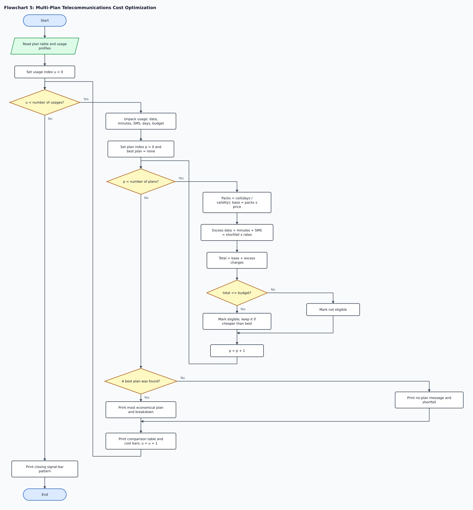
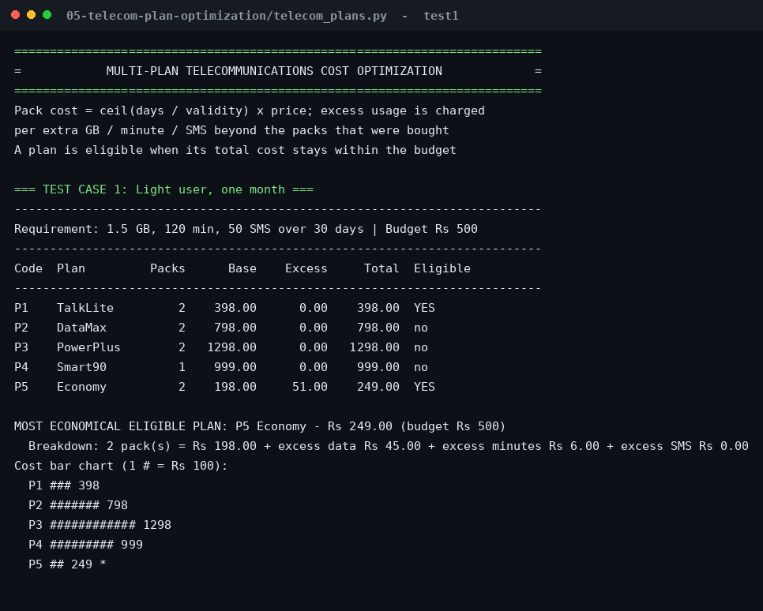
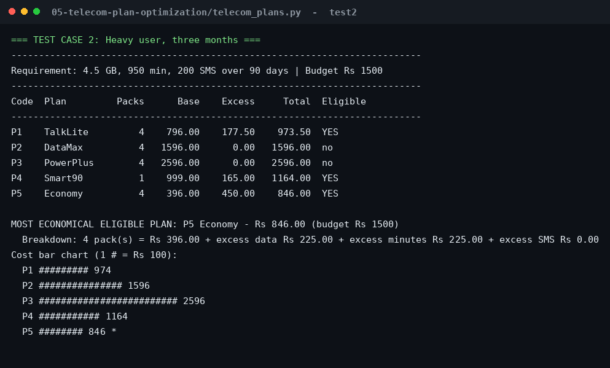
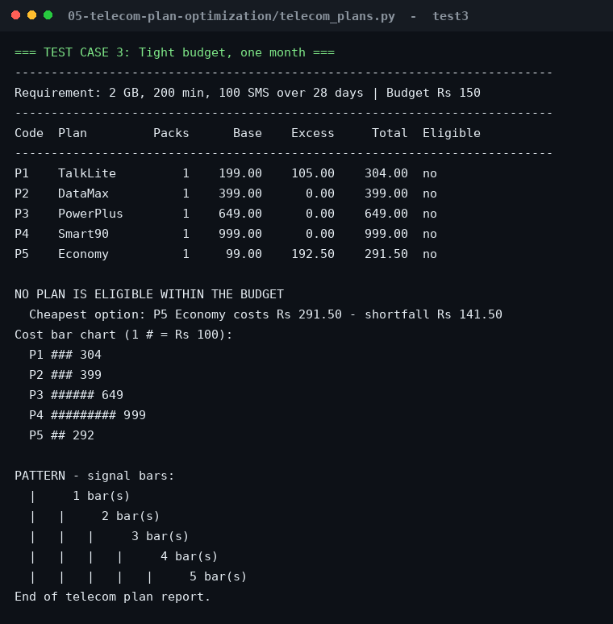

# Case Study 5 — Multi-Plan Telecommunications Cost Optimization

> **Syllabus used:** computational thinking · algorithms · flowcharts · pseudocode · variables · data types · operators · conditional statements · loops · strings · pattern generation · lists · nested lists · tuples · tuple operations · unpacking

## Deliverables Index

| # | Deliverable | Where to find it |
|---|-------------|------------------|
| 1 | Problem statement | [Section 1](#1-problem-statement) |
| 2 | Objectives | [Section 2](#2-objectives) |
| 3 | Assumptions | [Section 3](#3-assumptions) |
| 4 | Algorithm | [Section 4](#4-algorithm) |
| 5 | Flowchart | [Section 5](#5-flowchart) → [`flowchart.svg`](flowchart.svg) |
| 6 | Pseudocode | [Section 6](#6-pseudocode) |
| 7 | Python source code | [`telecom_plans.py`](telecom_plans.py) |
| 8 | Test cases | [Section 8](#8-test-cases) |
| 9 | Output screenshots | [Section 9](#9-output-screenshots) → `outputs/*.png` |
| 10 | Conclusion | [Section 10](#10-conclusion) |

---

## 1. Problem Statement

A customer wants the **cheapest mobile plan that still satisfies their usage
and budget**. Five plans are available; each specifies data (GB), voice
minutes, SMS, validity (days), price, and per-unit rates for excess data and
excess minutes (SMS excess is ₹0.25/message).

For every usage profile — data, minutes, SMS, **days of validity needed** and
a rupee budget — the system must:

1. work out how many **packs** must be bought
   (`packs = ceil(days ÷ validity)`), because a plan can be re-purchased when
   its validity expires,
2. compute the **base cost** = packs × price and the total allowances gained,
3. charge **excess usage** for every resource the allowances do not cover
   (shortfall × per-unit rate),
4. decide **eligibility**: total cost ≤ budget, and
5. select the **most economical eligible plan**, or report that no plan fits
   and name the cheapest option plus the **shortfall** in rupees.

## 2. Objectives

- Express the plan catalogue as a **list of tuples** and the usage profiles as
  a second list — then use **nested loops** (usages × plans) to evaluate every
  combination.
- Practise **tuple unpacking** with 9-field plan records and multi-field
  usage records.
- Implement **integer ceiling division** with the operator formula
  `(days + validity − 1) // validity` (no library functions).
- Use **conditional accumulation** (`if shortfall < 0: shortfall = 0`) and
  **sentinel-based minimum search** (best_total starts at −1) with tie-break
  rules expressed through `elif`.
- Present results as an aligned comparison table plus a **`#` cost-bar
  pattern** and a closing signal-bar pattern (pattern generation).

## 3. Assumptions

1. Plan data (per pack): P1 TalkLite 1 GB/100 min/100 SMS, 28 days, ₹199
   (₹80/extra GB, ₹0.25/min) · P2 DataMax 2 GB/300 min/300 SMS, 28 days, ₹399
   (₹70, ₹0.20) · P3 PowerPlus 5 GB/1000 min/1000 SMS, 28 days, ₹649
   (₹60, ₹0.10) · P4 Smart90 3 GB/500 min/500 SMS, 90 days, ₹999
   (₹65, ₹0.15) · P5 Economy 0.5 GB/50 min/50 SMS, 28 days, ₹99
   (₹90, ₹0.30).
2. Excess SMS is always ₹0.25 per message over the allowance.
3. Allowances scale with the number of packs bought (2 packs of P1 = 2 GB,
   200 minutes, 200 SMS, 56 days of validity).
4. Excess charges are computed once against the whole usage requirement (not
   per pack), i.e. `excess = max(0, required − allowance)`.
5. A plan is eligible iff its total cost ≤ budget; ties on total cost are
   broken by lower excess charges, then by list order (code order).
6. Days of need ≥ 1, so `ceil` is always defined; budget ≥ 0.
7. All test data are embedded; results are deterministic and rounded to
   2 decimals.

## 4. Algorithm

**Step 1 — Start.** Store the plan table, the SMS excess rate and three
usage profiles.

**Step 2 — For each usage profile (outer loop, unpacking):**
1. Print the requirement line (data/min/SMS/days/budget).
2. Create an empty `plan_rows` list.
3. **For each plan (inner loop, unpacking):**
   1. `packs = (days + validity − 1) // validity` (ceiling division),
      `base = packs × price`.
   2. Total allowances = per-pack allowance × packs.
   3. For data, minutes and SMS: `shortfall = required − allowance`;
      if negative, set to 0 (conditional).
   4. `excess = shortfall_data × gb_rate + shortfall_min × min_rate
      + shortfall_sms × 0.25`.
   5. `total = round(base + excess, 2)`; `eligible = total ≤ budget`.
   6. Append the result tuple to `plan_rows`.
4. Print the comparison table (code, plan, packs, base, excess, total,
   eligible).
5. **Select the best plan:** scan `plan_rows`; keep an eligible row when no
   best exists yet (`best_total < 0` sentinel), or when its total is lower,
   or when totals are equal but its excess is lower.
6. **If** a best plan exists → print its code, name, total and breakdown.
   **Else** → scan again for the cheapest (eligible or not), print the
   no-plan message and `shortfall = cheapest − budget`.
7. Print the `#` cost-bar pattern (1 `#` ≈ ₹100), marking the winner.

**Step 3 —** Print the closing signal-bar pattern.

**Step 4 — End.**

## 5. Flowchart



*Legend:* blue stadium = start/end · green parallelogram = input/output ·
white rectangle = process · yellow diamond = decision. Two nested loops
(usages → plans) surround the eligibility decision; after the inner loop a
decision chooses between the "winner" and "no plan" reports.

## 6. Pseudocode

```
BEGIN TELECOM PLAN OPTIMIZATION

    SET plans ← [(code, name, data, mins, sms, validity, price, gb_rate, min_rate), ...]
    SET sms_rate ← 0.25

    FOR each (label, need_data, need_min, need_sms, need_days, budget) IN usages DO
        plan_rows ← empty list
        FOR each plan IN plans DO
            UNPACK plan → code, name, data, mins, sms, validity, price, gb_rate, min_rate
            packs ← (need_days + validity - 1) // validity      // ceiling division
            base  ← packs * price
            extra_data ← max(0, need_data - data * packs)
            extra_min  ← max(0, need_min  - mins  * packs)
            extra_sms  ← max(0, need_sms  - sms   * packs)
            excess ← extra_data * gb_rate + extra_min * min_rate + extra_sms * sms_rate
            total  ← round(base + excess, 2)
            eligible ← (total <= budget)
            append (code, name, packs, base, ..., total, eligible) to plan_rows
        END FOR

        PRINT comparison table
        best_total ← -1                                     // sentinel
        FOR each row IN plan_rows DO
            IF row.eligible THEN
                IF best_total < 0
                   OR row.total < best_total
                   OR (row.total = best_total AND row.excess < best_excess)
                THEN keep row as best
            END IF
        END FOR

        IF best_total >= 0 THEN
            PRINT "MOST ECONOMICAL ELIGIBLE PLAN" + breakdown
        ELSE
            cheapest ← minimum total over all rows
            PRINT "NO PLAN IS ELIGIBLE" + shortfall (cheapest - budget)
        END IF
        PRINT cost-bar pattern marking the winner
    END FOR

    PRINT closing signal-bar pattern
END TELECOM PLAN OPTIMIZATION
```

## 7. Python Source Code

**File:** [`telecom_plans.py`](telecom_plans.py) — complete and runnable.

```bash
python3 telecom_plans.py
```

Only syllabus constructs are used: variables, data types, operators (incl.
`//` ceiling-division trick, arithmetic, comparison, logical), `if/elif/else`,
`for` loops, strings and f-strings, pattern generation, lists, nested lists,
tuples, tuple operations and unpacking — **no functions, no dictionaries, no
imports, no file I/O**.

## 8. Test Cases

| ID | Scenario | Input summary | Expected result |
|----|----------|---------------|-----------------|
| TC1 | Light user, 30 days, ₹500 budget | 1.5 GB, 120 min, 50 SMS | Eligible: P1 (₹398) and P5 (₹249 after ₹45 data + ₹6 minute excess) → **winner P5 Economy ₹249.00**; P2/P3/P4 over budget |
| TC2 | Heavy user, 90 days, ₹1,500 budget | 4.5 GB, 950 min, 200 SMS | P1 needs 4 packs (₹796 + ₹177.50 excess = ₹973.50 ✓), P4 1 pack (₹1,164 ✓), P5 4 packs (₹396 + ₹450 excess = ₹846 ✓) → **winner P5 Economy ₹846.00**; P2 ₹1,596 and P3 ₹2,596 ineligible |
| TC3 | Tight budget, 28 days, ₹150 budget | 2 GB, 200 min, 100 SMS | **Every plan exceeds the budget** → "NO PLAN IS ELIGIBLE"; cheapest is P5 Economy at ₹291.50 → **shortfall ₹141.50** |

**Hand-verification of TC1 / P5:**

| Step | Computation | Value |
|------|-------------|-------|
| Packs | ceil(30 ÷ 28) = (30+27) // 28 | 2 |
| Base | 2 × ₹99 | 198.00 |
| Data excess | 1.5 − (0.5 × 2) = 0.5 GB × ₹90 | 45.00 |
| Minute excess | 120 − (50 × 2) = 20 min × ₹0.30 | 6.00 |
| SMS excess | 50 − (50 × 2) ≤ 0 | 0.00 |
| **Total** | 198 + 45 + 6 | **249.00 ≤ 500 ✓** |

**Hand-verification of TC3 / P5 (no-plan path):** packs = 1 → base ₹99;
data excess (2 − 0.5) × 90 = ₹135; minute excess (200 − 50) × 0.30 = ₹45;
SMS excess (100 − 50) × 0.25 = ₹12.50 → total **₹291.50**; shortfall
291.50 − 150 = **₹141.50 ✓**.

**Boundary semantics verified:** exactly-30-days usage over a 28-day validity
forces a *second* pack (ceiling division), which changes the winner; zero-or-
negative shortfalls are clamped to 0 so allowances are never "refunded"; the
budget comparison is inclusive (≤).

## 9. Output Screenshots

Captured by running `python3 telecom_plans.py` (full text log:
[`outputs/run_output.txt`](outputs/run_output.txt)).

**Test Case 1 — Light user: comparison table, winner, cost bars:**



**Test Case 2 — Heavy user over 90 days (multi-pack math):**



**Test Case 3 — Tight budget: no eligible plan + shortfall:**



## 10. Conclusion

This case study turns a real "which plan should I buy?" question into a
**search problem**: enumerate every (usage × plan) combination, price it with
a small deterministic cost model, filter by budget, then take the minimum.

Key learnings:

- **Nested loops over two lists of tuples** implement the cross-product
  evaluation; unpacking 9-field plan tuples keeps the inner body readable.
- The **ceiling-division idiom** `(n + d − 1) // d` shows how operators
  replace library functions — here it drives multi-pack purchases.
- **Clamping conditionals** (`if extra < 0: extra = 0`) and a **sentinel
  minimum search** (`best_total = −1`) are reusable list-processing patterns;
  the tie-break chain (`elif total = best and excess < best_excess`) mirrors
  the scholarship ranking idea.
- Both **success and failure branches** are first-class outputs: when no plan
  fits, the program still identifies the cheapest option and quantifies the
  **shortfall** — the decision-support part of the problem.
- Aligned tables and two **bar patterns** (`#` cost bars, signal bars) show
  strings and pattern generation serving data presentation.
- Three profiles exercise multi-pack behaviour (30 days > 28), a 90-day
  single-pack plan, and the no-eligible-plan path — every figure was
  hand-verified (₹249.00, ₹846.00, ₹291.50/₹141.50).
