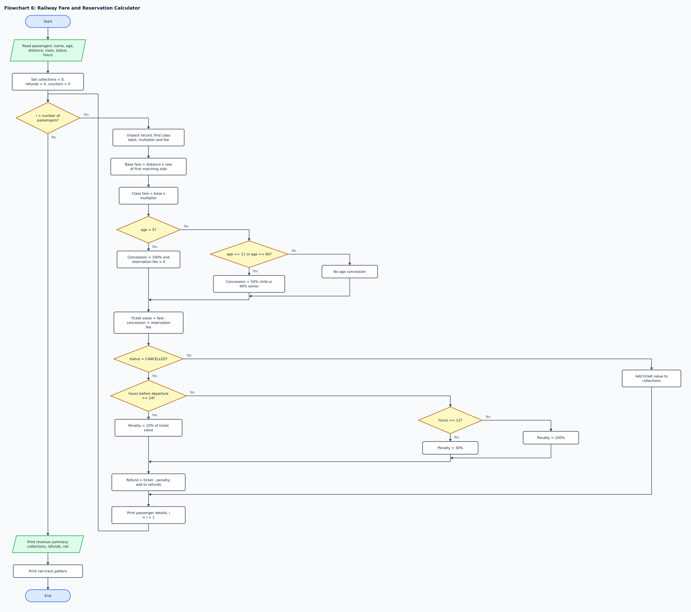
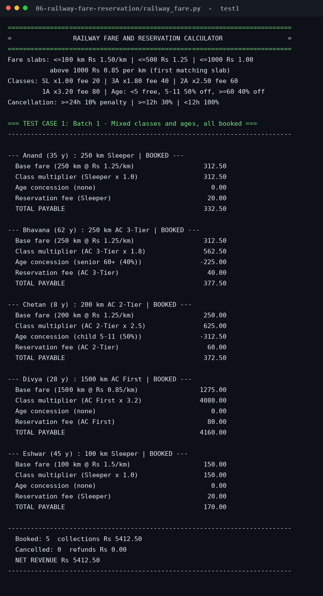
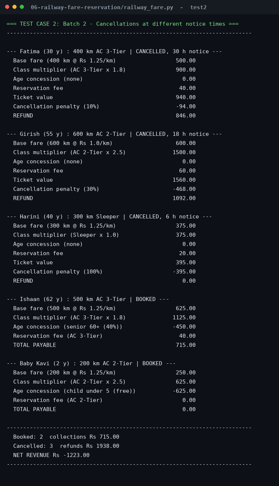
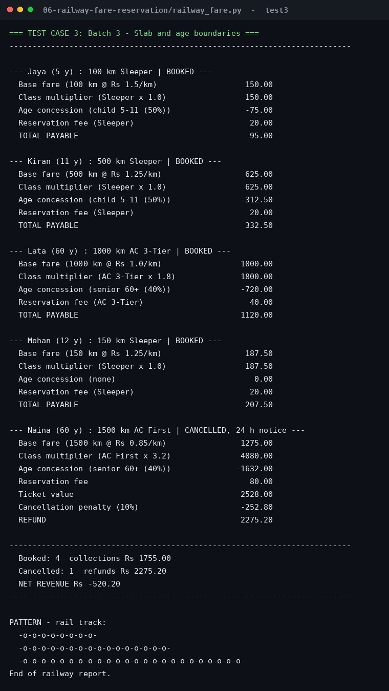

# Case Study 6 — Railway Fare and Reservation Calculator

> **Syllabus used:** computational thinking · algorithms · flowcharts · pseudocode · variables · data types · operators · conditional statements · loops · strings · pattern generation · lists · nested lists · tuples · tuple operations · unpacking

## Deliverables Index

| # | Deliverable | Where to find it |
|---|-------------|------------------|
| 1 | Problem statement | [Section 1](#1-problem-statement) |
| 2 | Objectives | [Section 2](#2-objectives) |
| 3 | Assumptions | [Section 3](#3-assumptions) |
| 4 | Algorithm | [Section 4](#4-algorithm) |
| 5 | Flowchart | [Section 5](#5-flowchart) → [`flowchart.svg`](flowchart.svg) |
| 6 | Pseudocode | [Section 6](#6-pseudocode) |
| 7 | Python source code | [`railway_fare.py`](railway_fare.py) |
| 8 | Test cases | [Section 8](#8-test-cases) |
| 9 | Output screenshots | [Section 9](#9-output-screenshots) → `outputs/*.png` |
| 10 | Conclusion | [Section 10](#10-conclusion) |

---

## 1. Problem Statement

A railway reservation counter must price tickets and handle cancellations for
a group of passengers. Each passenger record has a **name, age, journey
distance, travel class, booking status** and (for cancellations) the **notice
hours** before departure. The system must:

1. compute the **base fare** from a distance-slab table
   (≤ 100 km → ₹1.50/km · ≤ 500 → ₹1.25/km · ≤ 1000 → ₹1.00/km ·
   above → ₹0.85/km, first matching slab),
2. multiply by the **class multiplier** and add the class **reservation fee**
   (SL ×1.00 + ₹20 · 3A ×1.80 + ₹40 · 2A ×2.50 + ₹60 · 1A ×3.20 + ₹80),
3. apply **age-based concessions** — under 5 travels free (fare and fee zero),
   ages 5–11 get 50 % off, ages 60+ get 40 % off,
4. for **cancellations**, deduct a penalty based on notice time
   (≥ 24 h → 10 % · ≥ 12 h → 30 % · < 12 h → 100 %) and pay the refund, and
5. summarise **collections, refunds and net revenue** for the batch.

## 2. Objectives

- Practise **computational thinking**: fare → concession → booking-or-cancel
  → summarise.
- Store the distance slabs, class table and cancellation rules as **lists of
  tuples**; search them with loops (`break` on first match).
- Use **tuple unpacking** for both 4-field class records and 6-field
  passenger records inside **nested loops** (batches → passengers).
- Chain **conditional statements**: age ladder (`if/elif/elif`), status test
  and nested notice-time decisions (`hours >= 24` → else `hours >= 12`).
- Round money consistently with `round()` and present statements with
  **f-string** alignment; close with a **rail-track pattern** (pattern
  generation).

## 3. Assumptions

1. Base fare uses the **first matching** distance slab applied to the whole
   distance (not progressive): e.g. 250 km → ₹1.25/km for all 250 km.
2. Class fare = base fare × multiplier; reservation fee is added **after**
   the age concession and is per passenger.
3. Age rules are exclusive/ordered: age < 5 → 100 % concession and ₹0 fee;
   5 ≤ age ≤ 11 → 50 %; age ≥ 60 → 40 %; otherwise none. Age 12–59 pays
   full fare.
4. Cancellation penalty applies to the **ticket value** (fare after
   concession + reservation fee). Rules are checked in order (24 h, 12 h,
   0 h) so exactly 24 h → 10 % and exactly 12 h → 30 %.
5. Booked passengers have notice hours = 0 (unused for pricing).
6. A cancellation may result in a zero or positive refund only; negative
   refunds cannot occur because penalty rates ≤ 100 %.
7. All money is rounded to 2 decimals at each computed stage; test data are
   embedded and deterministic.

## 4. Algorithm

**Step 1 — Start.** Store `FARE_SLABS`, `CLASSES`, `CANCEL_RULES`,
concession constants and three batches of passenger tuples.

**Step 2 — For each batch (outer loop):** reset collections, refunds and
counters.

**Step 3 — For each passenger (loop with unpacking):**
1. Scan `CLASSES` for the class code → label, multiplier, reservation fee.
2. Scan `FARE_SLABS` for the first `distance ≤ limit` → rate (`break`).
   `base_fare = distance × rate`.
3. `class_fare = base_fare × multiplier`.
4. Age ladder with `if/elif/else`:
   - age < 5 → concession 100 %, reservation fee set to 0;
   - age ≤ 11 → concession 50 %;
   - age ≥ 60 → concession 40 %;
   - else 0 %.
   `concession = class_fare × rate`; `fare_after = class_fare − concession`;
   `ticket_value = fare_after + reservation_fee`.
5. Print the itemised passenger statement.
6. **If** status = CANCELLED:
   1. Scan `CANCEL_RULES` for the first `hours ≥ min_hours` → penalty rate.
   2. `penalty = ticket_value × rate`; `refund = ticket_value − penalty`;
      add refund to `total_refunds`.
   **Else** add `ticket_value` to `total_collections`.
7. Increment the booked/cancelled counters.

**Step 4 —** Print the batch summary (collections, refunds, net revenue).

**Step 5 —** Print the rail-track pattern (`-o` repeated by nested loops).

**Step 6 — End.**

## 5. Flowchart



*Legend:* blue stadium = start/end · green parallelogram = input/output ·
white rectangle = process · yellow diamond = decision. The age ladder is a
nested decision inside the "age < 5?" branch; the cancellation path nests the
two notice-time decisions before both branches rejoin the main flow.

## 6. Pseudocode

```
BEGIN RAILWAY FARE AND RESERVATION

    SET fare_slabs ← [(100,1.50), (500,1.25), (1000,1.00), (99999,0.85)]
    SET classes    ← [(SL, Sleeper, 1.00, 20), (3A, ..., 1.80, 40),
                      (2A, ..., 2.50, 60), (1A, ..., 3.20, 80)]
    SET cancel     ← [(24, 0.10), (12, 0.30), (0, 1.00)]

    FOR each (title, passengers) IN batches DO
        collections ← 0 , refunds ← 0
        FOR each passenger IN passengers DO
            UNPACK → name, age, distance, class_code, status, hours
            find class label, multiplier, fee from classes
            rate ← first slab where distance <= limit ; BREAK
            base_fare ← distance * rate
            class_fare ← base_fare * multiplier

            IF age < 5        THEN concession ← 100% , fee ← 0
            ELSE IF age <= 11 THEN concession ← 50%
            ELSE IF age >= 60 THEN concession ← 40%
            ELSE               concession ← 0%

            ticket_value ← class_fare - concession + fee
            PRINT itemised statement

            IF status = "CANCELLED" THEN
                p_rate ← first rule where hours >= min_hours ; BREAK
                penalty ← ticket_value * p_rate
                refunds ← refunds + (ticket_value - penalty)
            ELSE
                collections ← collections + ticket_value
            END IF
        END FOR
        PRINT collections, refunds, net revenue
    END FOR

    PRINT rail-track pattern
END RAILWAY FARE AND RESERVATION
```

## 7. Python Source Code

**File:** [`railway_fare.py`](railway_fare.py) — complete and runnable.

```bash
python3 railway_fare.py
```

Only syllabus constructs are used: variables, data types, operators,
`if/elif/else`, `for` loops with `break`, strings and f-strings, pattern
generation, lists, nested lists, tuples, tuple operations and unpacking —
**no functions, no dictionaries, no imports, no file I/O**.

## 8. Test Cases

| ID | Scenario | Input summary | Expected result |
|----|----------|---------------|-----------------|
| TC1 | Mixed classes and ages, all booked | Anand 35/250 km/SL · Bhavana 62/250/3A · Chetan 8/200/2A · Divya 28/1500/1A · Eshwar 45/100/SL | Payables **₹332.50, ₹377.50 (40 % senior), ₹372.50 (50 % child), ₹4,160.00 (0.85 slab), ₹170.00 (1.50 slab)**; collections **₹5,412.50** |
| TC2 | Cancellations at 30 h / 18 h / 6 h + senior + infant | Fatima 400 km/3A cancelled 30 h · Girish 600/2A cancelled 18 h · Harini 300/SL cancelled 6 h · Ishaan 62/500/3A booked · Baby Kavi 2/200/2A booked | Refunds **₹846.00 (10 %), ₹1,092.00 (30 %), ₹0.00 (100 %)**; Ishaan **₹715.00**; Baby Kavi **₹0.00** (free with ₹0 fee); refunds total ₹1,938.00, net ₹−1,223.00 |
| TC3 | Slab and age boundaries | Jaya **age 5**/100 km · Kiran **age 11**/500 km · Lata **age 60**/1000 km · Mohan age 12/150 km · Naina 60/1500/1A cancelled **exactly 24 h** | Jaya 100 km @ 1.50 → 50 % → **₹95.00**; Kiran 500 km @ 1.25 → 50 % → **₹332.50**; Lata 1000 km @ 1.00 → 40 % → **₹1,120.00**; Mohan full fare **₹207.50**; Naina ticket ₹2,528.00 → 10 % → **refund ₹2,275.20** |

**Hand-verification of TC2 / Girish (30 % band):**

| Step | Computation | Value |
|------|-------------|-------|
| Base | 600 km × ₹1.00 (slab ≤ 1000) | 600.00 |
| Class | 600 × 2.5 (AC 2-Tier) | 1,500.00 |
| Concession | none (age 55) | 0.00 |
| Ticket value | 1,500 + ₹60 reservation | 1,560.00 |
| Penalty | 18 h ≥ 12 h → 30 % | −468.00 |
| **Refund** | 1,560 − 468 | **1,092.00 ✓** |

**Boundary semantics verified:** distance exactly 100/500/1000 km uses that
slab's rate; age exactly 5 and 11 still receive the child concession while
age 12 does not; age exactly 60 receives the senior concession; notice of
exactly 24 h stays in the 10 % band; notice under 12 h forfeits the entire
ticket value (refund ₹0.00).

## 9. Output Screenshots

Captured by running `python3 railway_fare.py` (full text log:
[`outputs/run_output.txt`](outputs/run_output.txt)).

**Test Case 1 — Booked passengers: fare build-up per passenger:**



**Test Case 2 — Cancellations with three penalty bands:**



**Test Case 3 — Slab/age/notice boundaries + revenue summary:**



## 10. Conclusion

The railway calculator chains **three independent rule systems** — distance
slabs, class multipliers, age concessions and notice-based penalties — into
one passenger statement, then aggregates them into a revenue summary.

Key learnings:

- **Lists of tuples** (slabs, classes, cancellation rules) are searched by
  loops with `break`, giving deterministic first-match semantics that mirror
  how the policy documents are written.
- **Tuple unpacking** in the passenger loop makes the body read like prose
  (`name, age, distance, class_code, status, hours`), and the nested batch ×
  passenger loops demonstrate **nested list traversal**.
- The **age ladder** (`if/elif/elif/else`) and the **nested notice-time
  decisions** show how mutually exclusive conditions and nested branches map
  directly onto the flowchart's decision chain.
- Handling the free-child case by keeping the computed fare and granting a
  **100 % concession** (rather than special-casing zero) keeps the statement
  auditable — every rupee is explained by a line item.
- Three test batches covered every band boundary (distance 100/500/1000,
  age 5/11/60, notice 24 h) plus all three penalty rates; all printed values
  were verified by hand (₹332.50, ₹846.00, ₹1,092.00, ₹0.00, ₹2,275.20).
- The closing **rail-track pattern** (`-o-o-…` from nested loops) again shows
  pattern generation built from string repetition.
