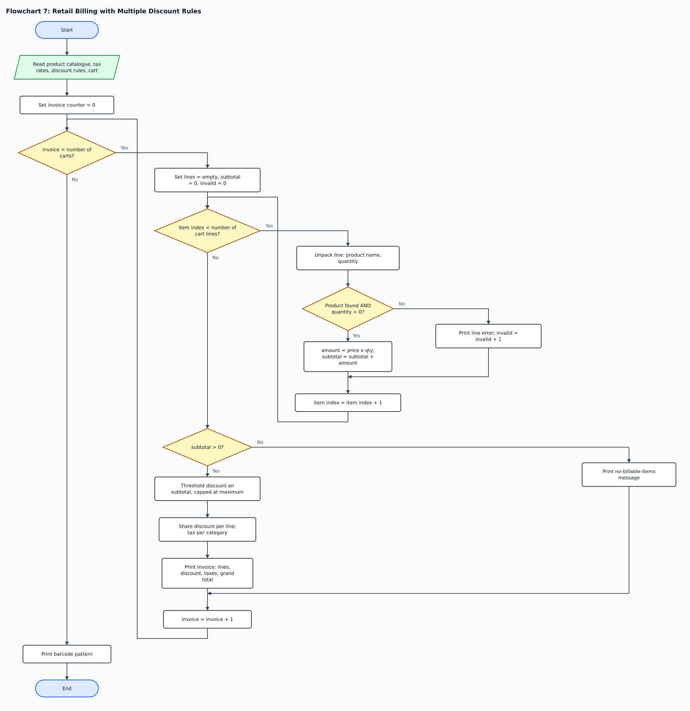
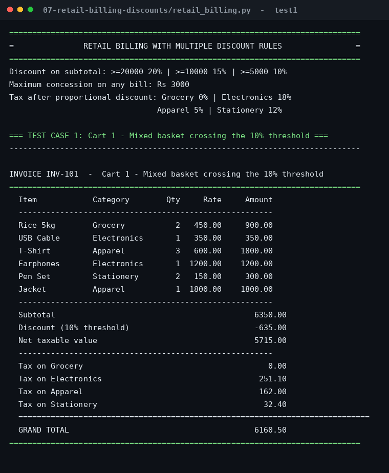
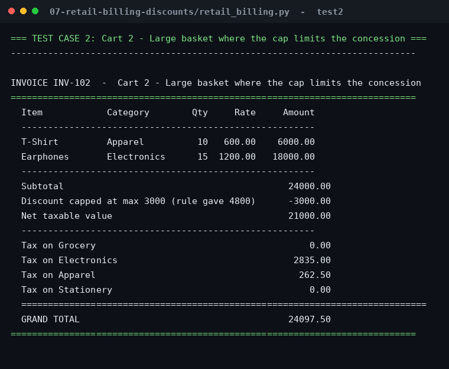
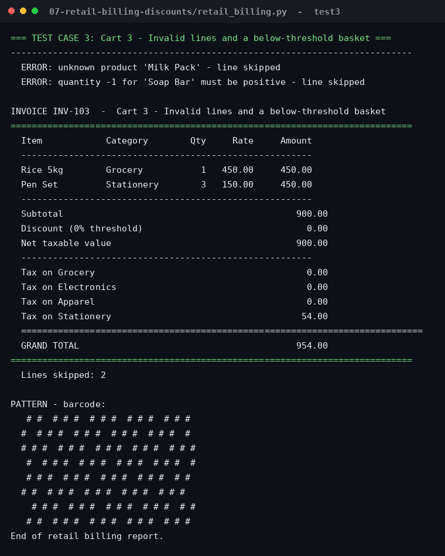

# Case Study 7 — Retail Billing with Multiple Discount Rules

> **Syllabus used:** computational thinking · algorithms · flowcharts · pseudocode · variables · data types · operators · conditional statements · loops · strings · pattern generation · lists · nested lists · tuples · tuple operations · unpacking

## Deliverables Index

| # | Deliverable | Where to find it |
|---|-------------|------------------|
| 1 | Problem statement | [Section 1](#1-problem-statement) |
| 2 | Objectives | [Section 2](#2-objectives) |
| 3 | Assumptions | [Section 3](#3-assumptions) |
| 4 | Algorithm | [Section 4](#4-algorithm) |
| 5 | Flowchart | [Section 5](#5-flowchart) → [`flowchart.svg`](flowchart.svg) |
| 6 | Pseudocode | [Section 6](#6-pseudocode) |
| 7 | Python source code | [`retail_billing.py`](retail_billing.py) |
| 8 | Test cases | [Section 8](#8-test-cases) |
| 9 | Output screenshots | [Section 9](#9-output-screenshots) → `outputs/*.png` |
| 10 | Conclusion | [Section 10](#10-conclusion) |

---

## 1. Problem Statement

A retail store issues invoices for customer carts. Each cart line names a
**product and quantity**; the product catalogue supplies the category and
unit price. The system must:

1. validate every cart line (unknown products and non-positive quantities are
   skipped with an error message),
2. compute the **subtotal** of the valid lines,
3. apply a **threshold discount** on the subtotal — ≥ ₹20,000 → 20 %,
   ≥ ₹10,000 → 15 %, ≥ ₹5,000 → 10 %, otherwise 0 % — subject to a
   **maximum concession of ₹3,000** on any bill,
4. distribute the discount across lines **proportionally** and charge
   **category-specific tax** (Grocery 0 %, Electronics 18 %, Apparel 5 %,
   Stationery 12 %) on each line's discounted value,
5. print an **itemised invoice** (lines, subtotal, discount, per-category tax
   grand total), and
6. issue a closing **barcode pattern**.

## 2. Objectives

- Practise **computational thinking**: validate → price → discount → tax →
  invoice.
- Store the catalogue, tax table and discount ladder as **nested lists of
  tuples** searched by loops.
- Use **tuple unpacking** for cart lines `(name, qty)` and catalogue records
  `(name, category, price)`.
- Implement **threshold selection** (first matching rung of a descending
  ladder) and a **cap** with `if`, plus **proportional allocation** using
  division and multiplication operators.
- Accumulate per-category tax into a **list of `(category, total)` tuples**
  rebuilt each line — list processing without dictionaries.
- Format a full invoice with **f-strings** and generate a **barcode pattern**
  with nested loops (pattern generation).

## 3. Assumptions

1. Catalogue: Rice 5kg ₹450 & Soap Bar ₹60 (Grocery) · USB Cable ₹350 &
   Earphones ₹1,200 (Electronics) · T-Shirt ₹600 & Jacket ₹1,800 (Apparel) ·
   Notebook ₹120 & Pen Set ₹150 (Stationery).
2. Discount ladder is tested from the highest threshold down; the first
   matching rung wins (so ≥ 20,000 always beats ≥ 10,000).
3. Discount is capped at **₹3,000**; when capped, the invoice states both the
   capped value and what the raw rule produced (transparency).
4. The discount is shared across lines in proportion to line amount ÷
   subtotal; tax is charged on `line amount − share` (tax never applies to
   discounted-away value).
5. Invalid lines (unknown product, quantity ≤ 0) are excluded from the
   subtotal and counted; a cart with no valid lines issues no invoice.
6. Money is rounded to 2 decimals for display; tax and totals are computed
   from unrounded intermediates then rounded for presentation.
7. All carts are embedded test data; runs are deterministic.

## 4. Algorithm

**Step 1 — Start.** Store `PRODUCTS`, `CAT_RATES`, `DISCOUNT_THRESHOLDS`,
`MAX_CONCESSION` and three carts.

**Step 2 — For each cart (outer loop):** create an invoice number.

1. **For each cart line (inner loop, unpacking):**
   1. Search `PRODUCTS` for the name → category and price.
   2. Unknown name → print error, increment `invalid`, skip.
   3. Quantity ≤ 0 → print error, increment `invalid`, skip.
   4. Else `amount = price × qty`; append the line tuple; add to `subtotal`.
2. **If** no valid lines → print "no billable items" and skip to next cart.
3. **Discount:** walk `DISCOUNT_THRESHOLDS` (descending) for the first
   `subtotal ≥ threshold` → rate; `raw = subtotal × rate`;
   `discount = min(raw, MAX_CONCESSION)` implemented with an `if`, remembering
   whether the cap bit.
4. **Tax:** seed an accumulator list `[(category, 0.0), …]`. For each valid
   line: `share = discount × amount / subtotal`,
   `taxable = amount − share`, `line_tax = taxable × rate(category)`;
   add `line_tax` to the line's category accumulator by rebuilding the list.
5. **Invoice:** print aligned item rows, subtotal, discount label (mentioning
   the cap when active), net taxable value, one tax row per category, and the
   grand total `subtotal − discount + Σ taxes`.
6. Print how many lines were skipped.

**Step 3 —** Print the barcode pattern (nested loops over rows/columns with
a modulo test).

**Step 4 — End.**

## 5. Flowchart



*Legend:* blue stadium = start/end · green parallelogram = input/output ·
white rectangle = process · yellow diamond = decision. Two nested loops
(carts → cart lines) surround the per-line validation decision; after the
inner loop a decision chooses the invoicing path or the empty-cart message.
The loop-exit spines deliberately run below the inner body so no line ever
crosses a process box (verified by `tools/check_flowcharts.py`).

## 6. Pseudocode

```
BEGIN RETAIL BILLING

    SET products ← [(name, category, price), ...]
    SET cat_rates ← [(Grocery, 0.00), (Electronics, 0.18),
                     (Apparel, 0.05), (Stationery, 0.12)]
    SET thresholds ← [(20000, 0.20), (10000, 0.15), (5000, 0.10), (0, 0)]
    SET max_concession ← 3000

    FOR each (title, cart) IN batches DO
        lines ← empty , subtotal ← 0 , invalid ← 0
        FOR each (product_name, qty) IN cart DO
            look up product_name in products
            IF not found            THEN print error ; invalid++ ; CONTINUE
            ELSE IF qty <= 0        THEN print error ; invalid++ ; CONTINUE
            ELSE
                amount ← price * qty
                append (name, category, qty, price, amount) to lines
                subtotal ← subtotal + amount
            END IF
        END FOR

        IF lines is empty THEN print "no billable items" ; CONTINUE

        rate ← 0
        FOR each (threshold, r) IN thresholds DO
            IF subtotal >= threshold THEN rate ← r ; BREAK
        END FOR
        raw ← subtotal * rate
        discount ← raw
        capped ← false
        IF discount > max_concession THEN
            discount ← max_concession ; capped ← true
        END IF

        cat_totals ← [(cat, 0) for every category]
        tax_sum ← 0
        FOR each line IN lines DO
            share ← discount * amount / subtotal
            line_tax ← (amount - share) * rate(category)
            tax_sum ← tax_sum + line_tax
            add line_tax to cat_totals[category]   // rebuild list
        END FOR

        PRINT itemised invoice, discount (cap note), tax rows,
              grand total = subtotal - discount + tax_sum
    END FOR

    PRINT barcode pattern
END RETAIL BILLING
```

## 7. Python Source Code

**File:** [`retail_billing.py`](retail_billing.py) — complete and runnable.

```bash
python3 retail_billing.py
```

Only syllabus constructs are used: variables, data types, operators,
`if/elif/else`, `for` loops with `continue`/`break`, strings and f-strings,
pattern generation, lists, nested lists, tuples, tuple operations and
unpacking — **no functions, no dictionaries, no imports, no file I/O**.

## 8. Test Cases

| ID | Scenario | Input summary | Expected result |
|----|----------|---------------|-----------------|
| TC1 | Mixed basket crossing 10 % | 6 lines: Rice ×2, USB ×1, T-Shirt ×3, Earphones ×1, Pen Set ×2, Jacket ×1 | Subtotal **₹6,350** → 10 % = **₹635**; per-category tax Grocery ₹0.00, Electronics ₹251.10, Apparel ₹162.00, Stationery ₹32.40 (sum ₹445.50); **GRAND TOTAL ₹6,160.50** |
| TC2 | Large basket hitting the cap | T-Shirt ×10 (₹6,000) + Earphones ×15 (₹18,000) | Subtotal **₹24,000**; 20 % rule gives ₹4,800 → **capped at ₹3,000** (invoice shows both numbers); net ₹21,000; tax Electronics ₹2,835.00 + Apparel ₹262.50 = ₹3,097.50; **GRAND TOTAL ₹24,097.50** |
| TC3 | Invalid lines + below-threshold basket | Rice ×1, "Milk Pack" ×2 (unknown), Soap Bar ×−1 (bad qty), Pen Set ×3 | Two ERROR lines printed; valid subtotal **₹900**; discount 0 %; tax Stationery ₹54.00; **GRAND TOTAL ₹954.00**; "Lines skipped: 2" |

**Hand-verification of TC1 (proportional discount share):**

| Line | Amount | Share of ₹635 (amount/6350 × 635) | Taxable | Tax | Rate |
|------|--------|-----------------------------------|---------|-----|------|
| Rice 5kg | 900 | 90.00 | 810.00 | 0.00 | 0 % |
| USB Cable | 350 | 35.00 | 315.00 | 56.70 | 18 % |
| T-Shirt | 1,800 | 180.00 | 1,620.00 | 81.00 | 5 % |
| Earphones | 1,200 | 120.00 | 1,080.00 | 194.40 | 18 % |
| Pen Set | 300 | 30.00 | 270.00 | 32.40 | 12 % |
| Jacket | 1,800 | 180.00 | 1,620.00 | 81.00 | 5 % |
| **Total** | **6,350** | **635.00 ✓** | **5,715.00** | **445.50** | — |

**Grand total check:** 6,350 − 635 + 445.50 = **6,160.50 ✓**.

**Boundary semantics verified:** a subtotal of exactly ₹5,000 qualifies for
10 % (≥ test); the cap compares strictly `>` so a discount of exactly ₹3,000
is *not* reduced; quantity 0 is rejected (must be positive); shares sum
exactly to the discount, so no rupee of concession escapes taxation rules.

## 9. Output Screenshots

Captured by running `python3 retail_billing.py` (full text log:
[`outputs/run_output.txt`](outputs/run_output.txt)).

**Test Case 1 — Itemised invoice with threshold discount and category taxes:**



**Test Case 2 — Maximum-concession cap in action:**



**Test Case 3 — Validation errors + below-threshold basket + barcode:**



## 10. Conclusion

The retail case study combines **validation, threshold pricing, capped
discounts and tax allocation** into one invoice pipeline — the richest rule
set of the series so far.

Key learnings:

- **Nested lists of tuples** model three different tables (catalogue, tax
  rates, discount ladder); linear search with `break` implements first-match
  semantics without dictionaries.
- **Proportional share allocation** (`share = discount × amount / subtotal`)
  shows arithmetic operators doing real financial logic, and the
  accumulator-list rebuild pattern (`updated = [] …`) is the syllabus-safe
  substitute for dict mutation.
- **Two-stage discount logic** — ladder selection then cap — demonstrates
  sequential `if` blocks, and the invoice reports *both* numbers when the cap
  binds, teaching transparency in billing output.
- **Error-tolerant loops** with `continue` skip bad lines while keeping the
  valid ones, mirroring the hospital case's validation approach.
- Aligned f-string columns, the `#`-style invoice rules and the closing
  **barcode pattern** reinforce strings and pattern generation.
- Three carts exercised: normal threshold, capped discount and invalid-input
  paths; every rupee (₹635 share split, ₹3,000 cap, ₹445.50 tax) was
  verified by hand.
