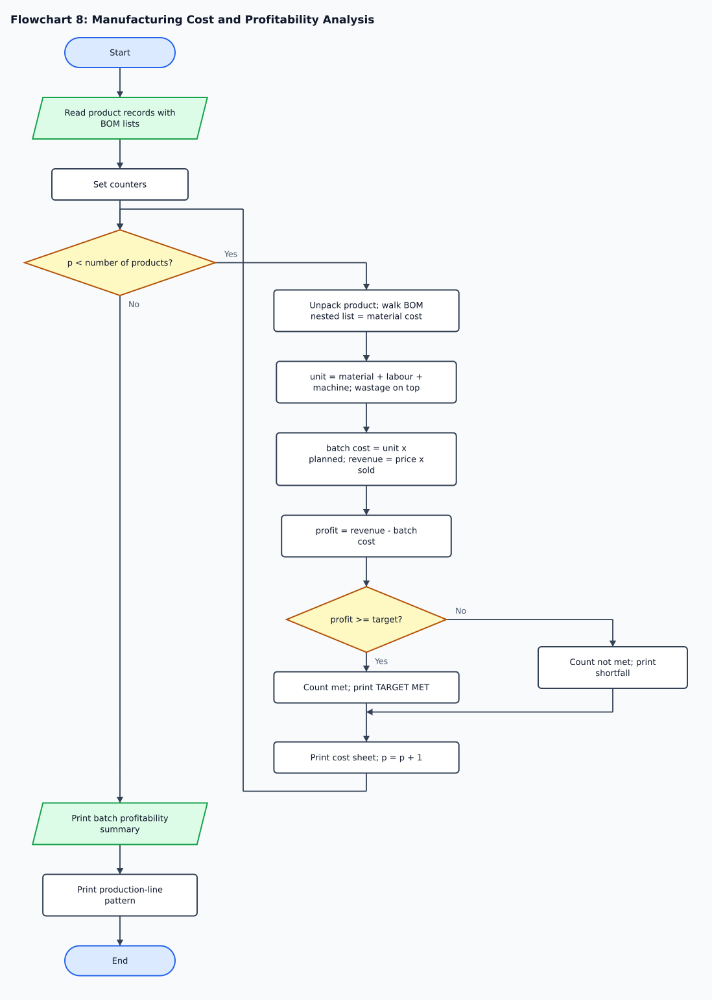
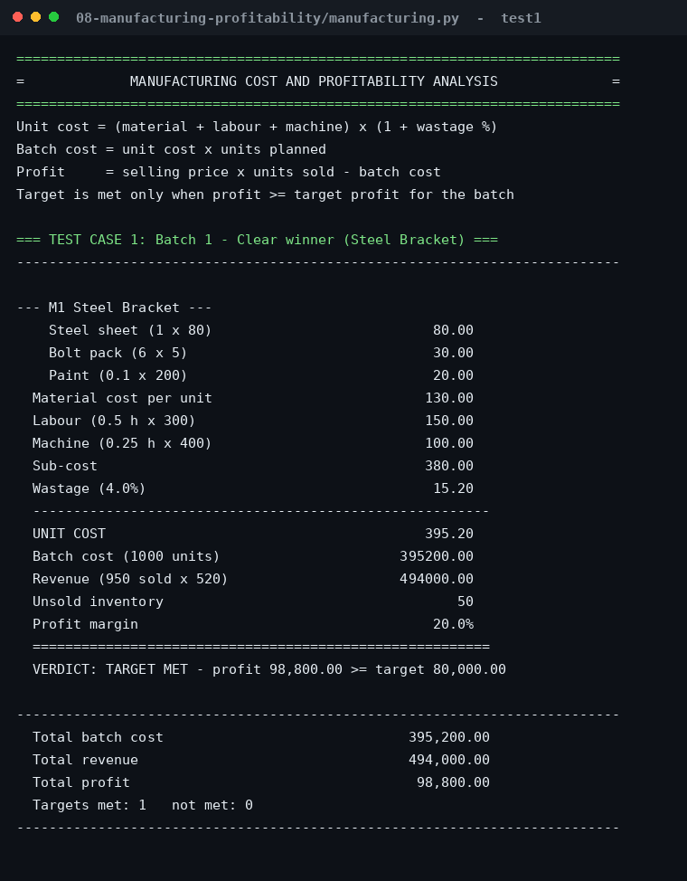
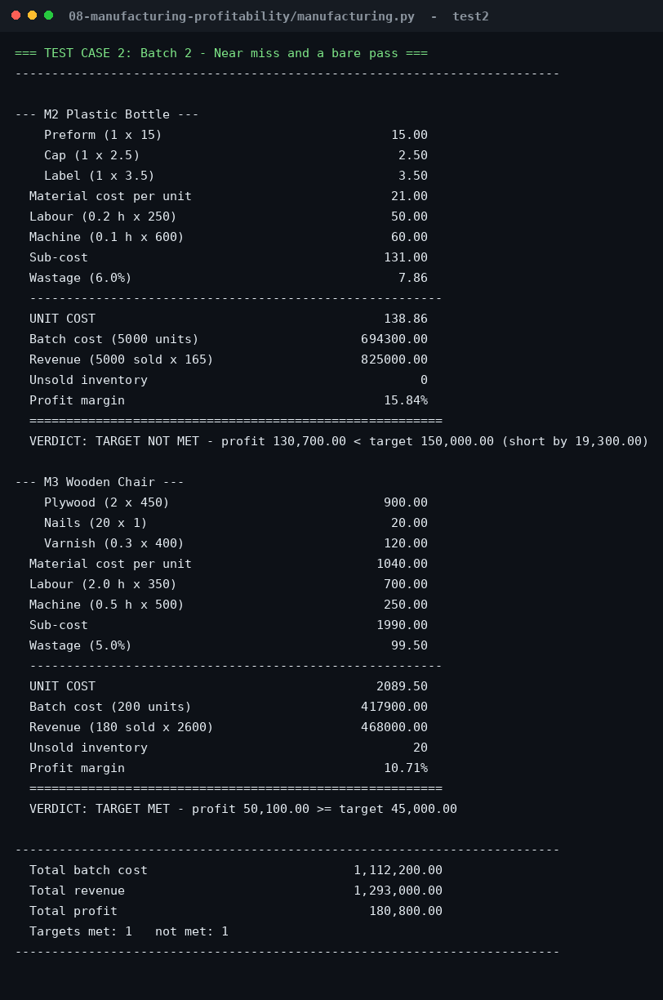
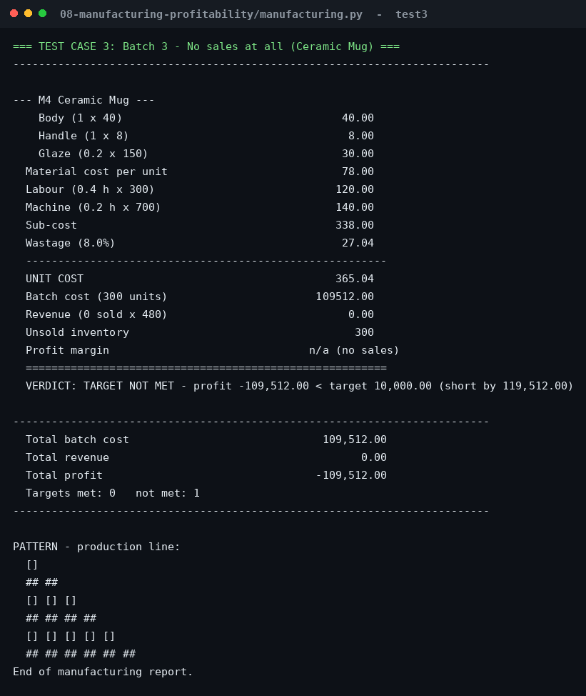

# Case Study 8 — Manufacturing Cost and Profitability Analysis

> **Syllabus used:** computational thinking · algorithms · flowcharts · pseudocode · variables · data types · operators · conditional statements · loops · strings · pattern generation · lists · nested lists · tuples · tuple operations · unpacking

## Deliverables Index

| # | Deliverable | Where to find it |
|---|-------------|------------------|
| 1 | Problem statement | [Section 1](#1-problem-statement) |
| 2 | Objectives | [Section 2](#2-objectives) |
| 3 | Assumptions | [Section 3](#3-assumptions) |
| 4 | Algorithm | [Section 4](#4-algorithm) |
| 5 | Flowchart | [Section 5](#5-flowchart) → [`flowchart.svg`](flowchart.svg) |
| 6 | Pseudocode | [Section 6](#6-pseudocode) |
| 7 | Python source code | [`manufacturing.py`](manufacturing.py) |
| 8 | Test cases | [Section 8](#8-test-cases) |
| 9 | Output screenshots | [Section 9](#9-output-screenshots) → `outputs/*.png` |
| 10 | Conclusion | [Section 10](#10-conclusion) |

---

## 1. Problem Statement

A factory produces four products from a **bill of materials (BOM)** — a
nested list of `(material, quantity per unit, rate)` tuples — plus labour
and machine time, and applies a **wastage percentage** on top of the base
cost. For every product the system must:

1. walk the BOM to compute the **material cost per unit**,
2. add **labour** (hours × rate) and **machine** (hours × rate) cost,
3. add **wastage** as a percentage of the base cost → **unit cost**,
4. compute **batch cost** (unit cost × units planned) and **revenue**
   (selling price × units sold),
5. compute **profit = revenue − batch cost** and the **profit margin %**,
6. decide whether the **target profit** for the batch is met (`≥`), and
7. print a per-product cost sheet plus a batch summary of met/not-met
   targets, ending with a production-line pattern.

## 2. Objectives

- Model a **real bill of materials** as a list of tuples inside a product
  tuple — nested data structures with tuple unpacking.
- Combine three cost components with **arithmetic operators** and apply a
  **percentage uplift** for wastage.
- Use a **while-style counted loop over a list of batches** (each batch a
  nested list of product tuples) to process production runs.
- Implement the **target decision** with `if/else` and a two-branch
  diamond in the flowchart; handle the **no-sales edge case** (margin
  undefined → `n/a`) with a conditional guard.
- Keep running **batch totals** with accumulation (`sum = sum + value`).
- Print aligned cost sheets with **f-strings** and close with a
  **pattern-generation** block (nested loops, alternating units).

## 3. Assumptions

1. Four products with BOMs: Steel Bracket (base ₹380/unit, wastage 4 %),
   Plastic Bottle (₹131, 6 %), Wooden Chair (₹1,990, 5 %), Ceramic Mug
   (₹338, 8 %).
2. Labour and machine cost = hours × hourly rate; rates are constant for
   the run.
3. Wastage is charged on (material + labour + machine) — i.e. unit cost =
   base × (1 + wastage %).
4. Batch cost is the full planned output (everything made is a cost);
   revenue counts only **units sold** — unsold stock is reported as
   inventory, not as profit.
5. Profit margin % = profit ÷ revenue × 100; when revenue is 0 the margin
   is printed as `n/a` instead of dividing by zero.
6. A target is **met** when profit ≥ target (equality passes); otherwise
   the shortfall (target − profit) is reported.
7. Money rounded to 2 decimals for display; all figures are embedded
   deterministic test data.

## 4. Algorithm

**Step 1 — Start.** Store the four product tuples and three batches
(each batch = description + list of products).

**Step 2 — For each batch:**

1. Initialise `met = 0`, `not_met = 0`, `sum_cost`, `sum_revenue`,
   `sum_profit` to zero.
2. **For each product tuple in the batch (unpacking):**
   1. Unpack code, name, BOM, labour hours/rate, machine hours/rate,
      wastage %, planned, sold, price, target.
   2. **Loop over the BOM:** `line_cost = qty × rate`; add to `material`
      and print each material line.
   3. `labour = hours × rate`, `machine = hours × rate`;
      `base = material + labour + machine`;
      `wastage = base × pct / 100`; `unit = base + wastage`.
   4. `batch_cost = unit × planned`; `revenue = price × sold`;
      `profit = revenue − batch_cost`; `unsold = planned − sold`.
   5. **If** revenue > 0 → `margin = profit × 100 / revenue`
      (rounded, printed); **else** print `n/a (no sales)`.
   6. **If** profit ≥ target → print TARGET MET and `met += 1`;
      **else** print TARGET NOT MET with the shortfall and
      `not_met += 1`.
   7. Add batch_cost, revenue, profit to the batch sums.
3. **Print the batch summary** (totals + counts of met/not met).

**Step 3 —** Print the production-line pattern (triangle of alternating
`[]`/`##` units, nested loops).

**Step 4 — End.**

## 5. Flowchart



*Legend:* blue stadium = start/end · green parallelogram = input/output ·
white rectangle = process · yellow diamond = decision. One outer loop
covers every product; inside it the profit-vs-target diamond has the only
two-way branch (met / not met), and the loop-exit spine runs below the
body so no flow line ever crosses a process box (verified by
`tools/check_flowcharts.py`).

## 6. Pseudocode

```
BEGIN MANUFACTURING ANALYSIS

    SET products ← [(code, name, BOM list, labour h, labour rate,
                     machine h, machine rate, wastage %,
                     planned, sold, price, target), ...]
    SET batches  ← [(title, list of product tuples), ...]

    FOR each (batch_title, batch) IN batches DO
        met ← 0 , not_met ← 0 , sum_cost ← 0 , sum_rev ← 0 , sum_profit ← 0
        FOR each (code, name, bom, lab_h, lab_rate, mac_h, mac_rate,
                  wastage_pct, planned, sold, price, target) IN batch DO
            material ← 0
            FOR each (mat, qty, rate) IN bom DO
                line ← qty * rate
                material ← material + line
            END FOR
            labour  ← lab_h * lab_rate
            machine ← mac_h * mac_rate
            base    ← material + labour + machine
            wastage ← base * wastage_pct / 100
            unit    ← base + wastage
            batch_cost ← unit * planned
            revenue    ← price * sold
            profit     ← revenue - batch_cost

            IF revenue > 0 THEN margin ← round(profit * 100 / revenue, 2)
            ELSE            margin ← "n/a"

            IF profit >= target THEN
                print TARGET MET ; met ← met + 1
            ELSE
                print TARGET NOT MET (shortfall = target - profit)
                not_met ← not_met + 1
            END IF
            sum_cost ← sum_cost + batch_cost
            sum_rev ← sum_rev + revenue
            sum_profit ← sum_profit + profit
        END FOR
        PRINT batch summary
    END FOR

    PRINT production-line pattern
END MANUFACTURING ANALYSIS
```

## 7. Python Source Code

**File:** [`manufacturing.py`](manufacturing.py) — complete and runnable.

```bash
python3 manufacturing.py
```

Only syllabus constructs are used: variables, data types, operators,
`if/elif/else`, `for` loops, strings and f-strings, pattern generation,
lists, nested lists, tuples, tuple operations and unpacking — **no
functions, no dictionaries, no imports, no file I/O**.

## 8. Test Cases

| ID | Scenario | Input summary | Expected result |
|----|----------|---------------|-----------------|
| TC1 | Clear winner | Steel Bracket: BOM ₹130 + labour ₹150 + machine ₹100 → base ₹380; wastage 4 %; 1,000 planned, 950 sold @ ₹520; target ₹80,000 | Unit cost **₹395.20**; batch **₹395,200**; revenue **₹494,000**; unsold 50; margin **20.00 %**; profit **₹98,800 ≥ ₹80,000 → TARGET MET** |
| TC2 | Near miss + bare pass | Bottle (base ₹131, 6 %, 5,000×₹165, target ₹1,50,000) and Chair (base ₹1,990, 5 %, 200 planned/180 sold @ ₹2,600, target ₹45,000) | Bottle unit **₹138.86**, profit **₹1,30,700 < ₹1,50,000 → NOT MET (short by ₹19,300)**, margin 15.84 %; Chair unit **₹2,089.50**, profit **₹50,100 ≥ ₹45,000 → MET**, margin 10.71 %; batch totals ₹1,112,200 / ₹1,293,000 / ₹1,80,800; **met 1, not met 1** |
| TC3 | No sales at all | Ceramic Mug: base ₹338, 8 % wastage; 300 planned, **0 sold**; target ₹10,000 | Unit **₹365.04**; batch **₹109,512**; revenue **0.00**; margin **n/a (no sales)**; profit **−₹1,09,512 → NOT MET, short by ₹1,19,512**; met 0, not met 1 |

**Hand-verification highlights**

- TC1 wastage: 380 × 0.04 = **15.20** ✓ → unit 395.20; ×1000 = 395,200 ✓;
  profit 494,000 − 395,200 = **98,800** ✓; margin 98,800 ÷ 494,000 = 0.20
  exactly → **20.0 %** ✓.
- TC2 Bottle wastage: 131 × 0.06 = **7.86** ✓ → unit 138.86; ×5000 =
  694,300 ✓; profit 825,000 − 694,300 = **130,700** ✓; shortfall
  150,000 − 130,700 = **19,300** ✓; margin 130,700 ÷ 825,000 = 0.15842…
  → **15.84 %** ✓.
- TC2 Chair: 2,089.50 × 200 = **417,900** ✓; revenue 180 × 2,600 =
  **468,000** ✓; profit **50,100** ✓; margin 50,100 ÷ 468,000 = 0.10705…
  → **10.71 %** ✓. Batch sums: 694,300 + 417,900 = **1,112,200** ✓.
- TC3: 338 × 0.08 = **27.04** ✓ → unit 365.04; ×300 = **109,512** ✓;
  shortfall 10,000 − (−109,512) = **119,512** ✓.
- Boundary semantics: profit exactly equal to target would print MET
  (`>=`); unsold inventory is a cost (not revenue); division by zero is
  avoided by the revenue > 0 guard.

## 9. Output Screenshots

Captured by running `python3 manufacturing.py` (full text log:
[`outputs/run_output.txt`](outputs/run_output.txt)).

**Test Case 1 — Clear winner with full cost sheet:**



**Test Case 2 — Near miss and a bare pass:**



**Test Case 3 — No sales: margin guard and loss verdict:**



## 10. Conclusion

The manufacturing case study ties the syllabus together around a
**nested-list bill of materials** — the deepest data structure in the
series:

- The BOM is a **list of tuples inside a tuple**, walked with a loop and
  unpacked three ways at a time (`material, qty, rate`), giving a genuine
  use for nested lists.
- Cost accumulation uses plain **arithmetic operators** (`+`, `*`, `/`
  with wastage as `base × pct / 100`), and the profit decision is a
  single `>=` comparison mirrored by the flowchart's second two-branch
  diamond.
- The **no-sales guard** (`if revenue > 0`) shows how conditionals
  protect arithmetic from undefined results — a real engineering habit.
- Three scenarios covered the full verdict space: a clear win (20 %
  margin), a **near miss** (₹19,300 short of target — teaching that
  "close" still fails) and a total loss with unsold inventory.
- Aligned cost-sheet f-strings and the alternating `[]`/`##`
  production-line pattern reinforce strings and pattern generation.
- Every figure (wastage fractions, unit costs, batch sums, margins,
  shortfalls) was verified by hand against the printed report.
