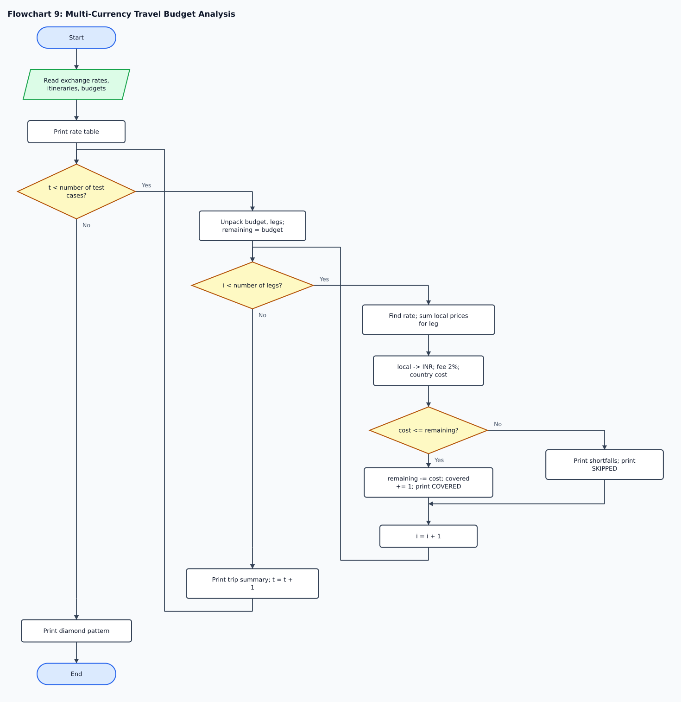
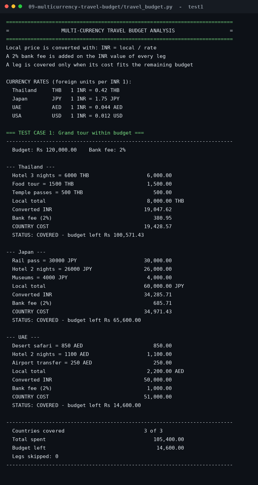
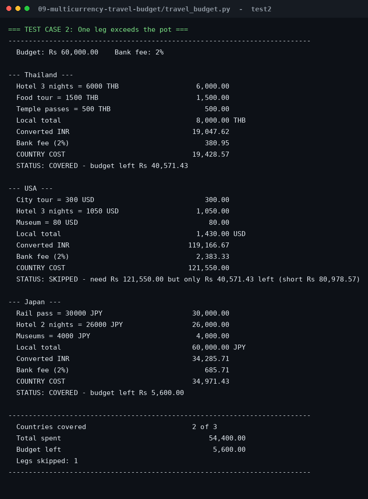
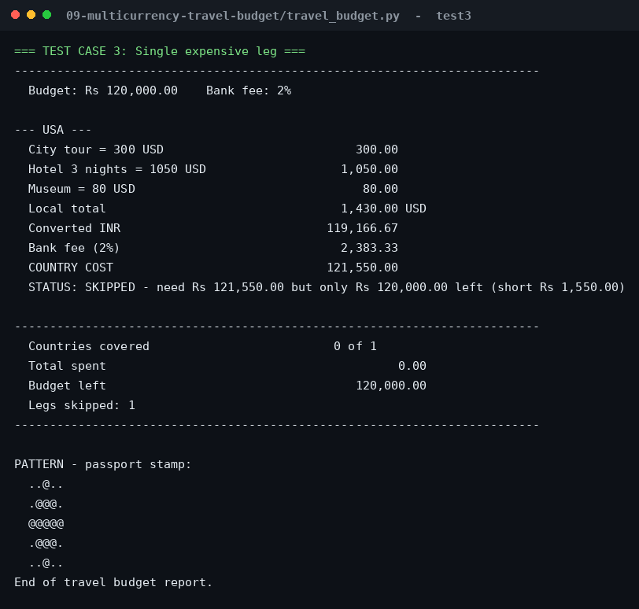

# Case Study 9 — Multi-Currency Travel Budget Analysis

> **Syllabus used:** computational thinking · algorithms · flowcharts · pseudocode · variables · data types · operators · conditional statements · loops · strings · pattern generation · lists · nested lists · tuples · tuple operations · unpacking

## Deliverables Index

| # | Deliverable | Where to find it |
|---|-------------|------------------|
| 1 | Problem statement | [Section 1](#1-problem-statement) |
| 2 | Objectives | [Section 2](#2-objectives) |
| 3 | Assumptions | [Section 3](#3-assumptions) |
| 4 | Algorithm | [Section 4](#4-algorithm) |
| 5 | Flowchart | [Section 5](#5-flowchart) → [`flowchart.svg`](flowchart.svg) |
| 6 | Pseudocode | [Section 6](#6-pseudocode) |
| 7 | Python source code | [`travel_budget.py`](travel_budget.py) |
| 8 | Test cases | [Section 8](#8-test-cases) |
| 9 | Output screenshots | [Section 9](#9-output-screenshots) → `outputs/*.png` |
| 10 | Conclusion | [Section 10](#10-conclusion) |

---

## 1. Problem Statement

A traveller plans a multi-country trip with a fixed budget in rupees.
Each destination prices its itinerary in a **local currency**, and a bank
adds a **2 % conversion fee** on the INR value of every leg. The system
must:

1. print a **currency-rate table** (`1 INR = rate foreign units`),
2. for each planned leg, sum the **local prices** of its itinerary items,
3. convert to INR (`INR = local ÷ rate`), add the 2 % fee → **country
   cost**,
4. decide whether the cost fits the **remaining budget**:
   - **covered** → deduct the cost and continue,
   - **not affordable** → skip the leg, report the **shortfall**, and
     leave the budget untouched (a later, cheaper leg may still fit),
5. print a trip summary (countries covered, total spent, budget left,
   legs skipped), and
6. finish with a **passport-stamp diamond pattern**.

## 2. Objectives

- Practise **computational thinking** for a resource-allocation problem
  with sequential dependencies (each leg changes what later legs can
  afford).
- Store rates, itineraries and test plans as **lists and nested lists of
  tuples**; unpack `(item, price)` pairs inside nested loops.
- Use **division and percentage operators** for currency conversion and
  bank fees; compare with `<=` to gate the affordability decision.
- Demonstrate **running-state logic** (`remaining = remaining - cost`)
  and a conditional that either deducts or reports a shortfall — the
  same decision shape as the flowchart's diamond.
- Format money with **f-strings** (`:,.2f`) and build the closing
  **diamond pattern** with nested loops (pattern generation).

## 3. Assumptions

1. Rates (foreign units per ₹1): Thailand 0.42 THB, Japan 1.75 JPY,
   UAE 0.044 AED, USA 0.012 USD — i.e. 1 US$ ≈ ₹83.33.
2. Bank fee = 2 % of the converted INR value, added to the leg cost.
3. A leg is **covered** only when `country_cost ≤ remaining`; a skipped
   leg does **not** reduce the budget, so later cheaper legs can still be
   afforded.
4. Legs are processed in itinerary order; conversion happens per leg at
   the listed rate (no rate drift).
5. Displayed INR figures are rounded to 2 decimals; the running balance
   is updated with the rounded country cost so printed values reconcile.
6. All budgets and itineraries are embedded test data; runs are
   deterministic.

## 4. Algorithm

**Step 1 — Start.** Store `exchange_rates`, `itineraries` (nested list of
country → item tuples) and `test_cases` (title, budget, legs).

**Step 2 — Print the rate table** (loop over `exchange_rates` with
unpacking).

**Step 3 — For each test case (outer loop):**

1. Unpack `budget` and `legs`; `remaining = budget`, counters at zero.
2. **For each country in legs (inner loop):**
   1. Find the country's rate by linear search (break on match).
   2. Find the country's itinerary; **unpack and sum** every
      `(item, local_price)` tuple, printing each line.
   3. `inr = local_total ÷ rate`;
      `fee = inr × 2 ÷ 100`;
      `cost = inr + fee`.
   4. **If** `cost ≤ remaining` →
      `remaining = remaining − cost`, `spent += cost`, `covered += 1`,
      print COVERED with the new balance;
      **else** → `shortfall = cost − remaining`, `skipped += 1`, print
      SKIPPED with the shortfall (budget unchanged).
3. **Print the trip summary** (covered count, total spent, budget left,
   legs skipped).

**Step 4 —** Print the passport-stamp diamond pattern (nested loops,
Manhattan distance test).

**Step 5 — End.**

## 5. Flowchart



*Legend:* blue stadium = start/end · green parallelogram = input/output ·
white rectangle = process · yellow diamond = decision. Two nested loops
(test cases → legs) surround the affordability diamond; its two branches
rejoin immediately (deduct vs report shortfall), and the exit spines run
below the bodies so no line crosses a process box (verified by
`tools/check_flowcharts.py`).

## 6. Pseudocode

```
BEGIN TRAVEL BUDGET

    SET rates   ← [(country, code, rate), ...]
    SET itin    ← [(country, [(item, local price), ...]), ...]
    SET cases   ← [(title, budget, [legs]), ...]
    SET fee_rate ← 2

    PRINT rate table

    FOR each (title_text, budget, legs) IN cases DO
        remaining ← budget , covered ← 0 , skipped ← 0 , spent ← 0
        FOR each country IN legs DO
            rate ← search rates for country
            items ← search itin for country
            local_total ← 0
            FOR each (item, price) IN items DO
                local_total ← local_total + price
            END FOR
            inr   ← local_total / rate
            fee   ← inr * fee_rate / 100
            cost  ← inr + fee

            IF cost <= remaining THEN
                remaining ← remaining - cost
                spent ← spent + cost
                covered ← covered + 1
                print COVERED with balance left
            ELSE
                print SKIPPED with shortfall = cost - remaining
                skipped ← skipped + 1
            END IF
        END FOR
        PRINT trip summary
    END FOR

    PRINT diamond pattern
END TRAVEL BUDGET
```

## 7. Python Source Code

**File:** [`travel_budget.py`](travel_budget.py) — complete and runnable.

```bash
python3 travel_budget.py
```

Only syllabus constructs are used: variables, data types, operators,
`if/else`, `for` loops, strings and f-strings, pattern generation, lists,
nested lists, tuples, tuple operations and unpacking — **no functions, no
dictionaries, no imports, no file I/O**.

## 8. Test Cases

| ID | Scenario | Input summary | Expected result |
|----|----------|---------------|-----------------|
| TC1 | Grand tour within budget | Budget **₹1,20,000**; legs Thailand → Japan → UAE | All **3 of 3 covered**: TH cost **₹19,428.57** (left ₹1,00,571.43), JP **₹34,971.43** (left ₹65,600.00), AE **₹51,000.00** (left **₹14,600.00**); spent **₹1,05,400.00**, 0 skipped |
| TC2 | One leg exceeds the pot | Budget **₹60,000**; legs Thailand → **USA** → Japan | Thailand covered (left ₹40,571.43); **USA SKIPPED** — needs ₹1,21,550.00, short **₹80,978.57** (budget untouched); Japan still fits → left **₹5,600.00**; **2 of 3 covered**, spent ₹54,400.00, 1 skipped |
| TC3 | Single expensive leg | Budget **₹1,20,000**; lone leg USA (cost ₹1,21,550.00) | **SKIPPED, short ₹1,550.00** — a near-miss; **0 of 1 covered**, spent **₹0.00**, budget left **₹1,20,000.00** |

**Hand-verification of the conversions**

| Leg | Local | ÷ rate | INR | Fee 2 % | Country cost |
|-----|-------|--------|-----|---------|--------------|
| Thailand | 8,000.00 THB | ÷ 0.42 | 19,047.62 | 380.95 | **19,428.57** |
| Japan | 60,000.00 JPY | ÷ 1.75 | 34,285.71 | 685.71 | **34,971.43** |
| UAE | 2,200.00 AED | ÷ 0.044 | 50,000.00 | 1,000.00 | **51,000.00** |
| USA | 1,430.00 USD | ÷ 0.012 | 119,166.67 | 2,383.33 | **121,550.00** |

**Boundary semantics verified:** TC2 proves a skipped leg leaves the
budget untouched (Japan is affordable *after* the USA is rejected); TC3
shows `cost ≤ remaining` failing by ₹1,550 exactly (equal would pass);
fees are computed on the INR value only; rounded costs reconcile —
1,05,400 + 14,600 = 1,20,000 in TC1, and 54,400 + 5,600 = 60,000 in TC2.

## 9. Output Screenshots

Captured by running `python3 travel_budget.py` (full text log:
[`outputs/run_output.txt`](outputs/run_output.txt)).

**Test Case 1 — Grand tour, every leg covered:**



**Test Case 2 — USA leg skipped, Japan still affordable:**



**Test Case 3 — Near-miss on a single leg:**



## 10. Conclusion

The travel-budget case study is the series' **stateful allocation**
problem: the decision in one iteration changes the options available to
the next.

Key learnings:

- **Nested lists of tuples** hold two levels of real-world data
  (country → itinerary items) and are unpacked twice — `(country, code,
  rate)` and `(item, price)` — reinforcing tuple operations.
- **Conversion arithmetic** (`local ÷ rate`, `× 2 ÷ 100`) uses basic
  operators on floats, with `:,.2f` f-strings keeping the report
  readable across four currencies.
- The **affordability diamond** (`cost ≤ remaining`) drives both flow
  branches of the flowchart; the "skip without deducting" rule is a
  deliberate business decision that the three test cases pin down
  (all-fit, skip-then-fit, near-miss).
- **Running-state updates** (`remaining = remaining − cost`) preview the
  accumulator pattern used throughout programming, made visible by
  printed balances after every leg.
- The closing **diamond pattern** (nested loops + distance test) adds a
  second, different pattern-generation technique to the portfolio.
- Every conversion, fee and balance was checked by hand and reconciles
  to the rupee (TC1: 1,05,400 + 14,600 = 1,20,000).
