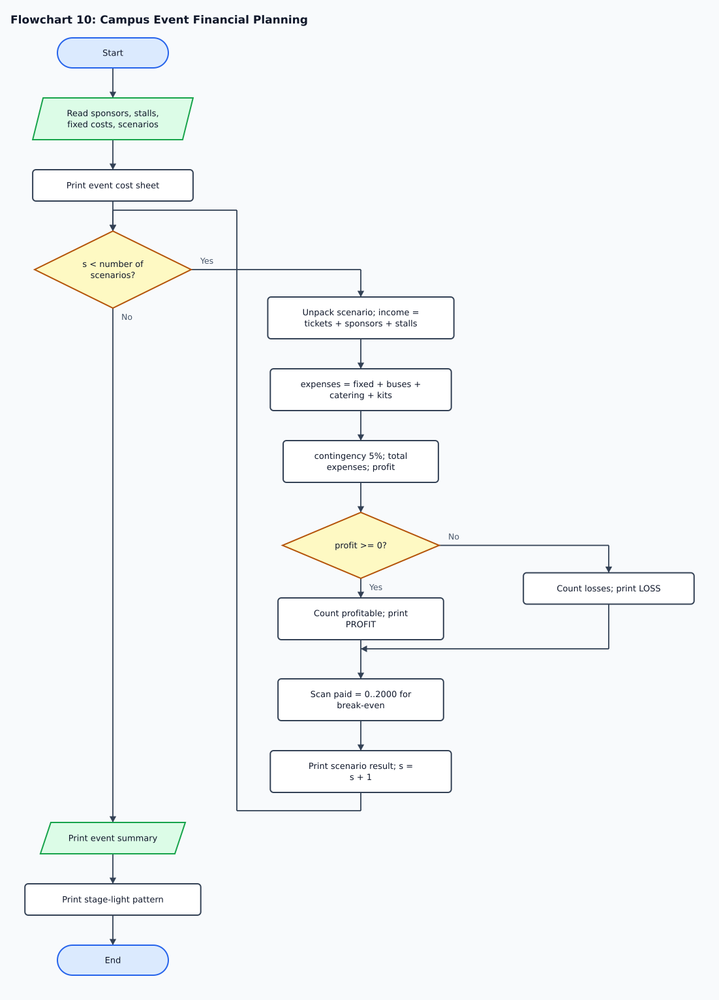
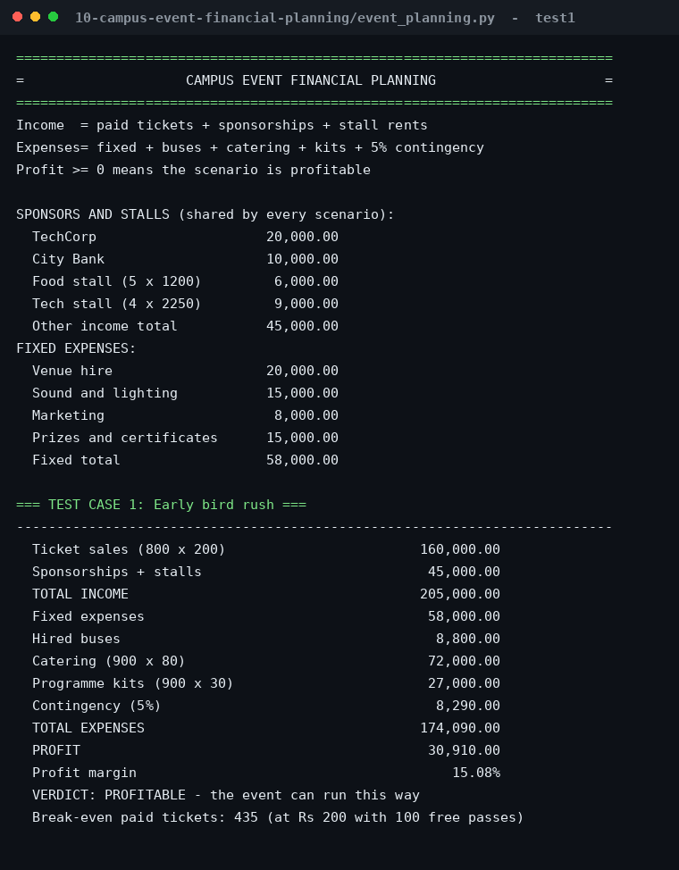
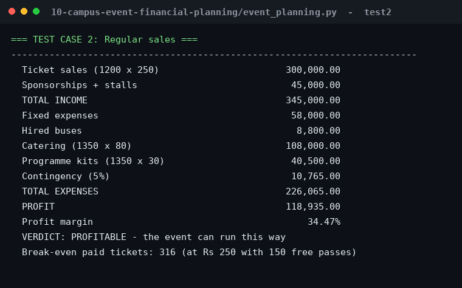
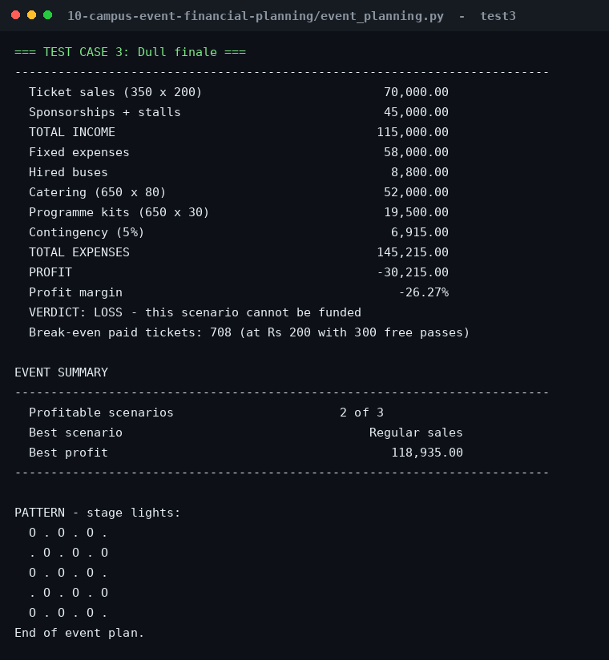

# Case Study 10 — Campus Event Financial Planning

> **Syllabus used:** computational thinking · algorithms · flowcharts · pseudocode · variables · data types · operators · conditional statements · loops · strings · pattern generation · lists · nested lists · tuples · tuple operations · unpacking

## Deliverables Index

| # | Deliverable | Where to find it |
|---|-------------|------------------|
| 1 | Problem statement | [Section 1](#1-problem-statement) |
| 2 | Objectives | [Section 2](#2-objectives) |
| 3 | Assumptions | [Section 3](#3-assumptions) |
| 4 | Algorithm | [Section 4](#4-algorithm) |
| 5 | Flowchart | [Section 5](#5-flowchart) → [`flowchart.svg`](flowchart.svg) |
| 6 | Pseudocode | [Section 6](#6-pseudocode) |
| 7 | Python source code | [`event_planning.py`](event_planning.py) |
| 8 | Test cases | [Section 8](#8-test-cases) |
| 9 | Output screenshots | [Section 9](#9-output-screenshots) → `outputs/*.png` |
| 10 | Conclusion | [Section 10](#10-conclusion) |

---

## 1. Problem Statement

A student club is planning a campus fest and must decide which attendance
scenario to run. Income comes from **paid tickets** (price varies by
scenario), **sponsorships** and **stall rents** (shared across
scenarios). Expenses include **fixed heads** (venue, sound, marketing,
prizes), **hired buses**, **catering and kits per attendee**, plus a
**5 % contingency** on all direct expenses. For every scenario the system
must:

1. compute total income (tickets + sponsors + stalls),
2. compute total expenses (fixed + buses + per-attendee heads +
   contingency),
3. decide **profitable or loss** (`profit ≥ 0`) and the profit margin,
4. find the **break-even number of paid tickets** by scanning paid
   counts upward until profit first reaches zero or more,
5. print a scenario table, an event summary (profitable count, best
   scenario), and close with a **stage-light pattern**.

## 2. Objectives

- Combine **three income sources and five expense heads** using
  accumulation loops over lists of tuples.
- Use **nested tuples** for stalls `(type, count, rent)` — an inner
  multiplication inside a loop over the outer list.
- Practise **per-scenario state**: each iteration rebuilds income and
  expense from scratch, then compares with `>= 0`.
- Implement a **break-even search** with a bounded `for` loop and
  `break` — algorithmic thinking without closed-form algebra.
- Track the **best scenario** with sequential `if` comparisons (no
  `max()` needed) and print margins with **f-string** formatting.
- Close with a **stage-light pattern** (nested loops, parity test).

## 3. Assumptions

1. Shared income: sponsors TechCorp ₹20,000 + City Bank ₹10,000; stalls
   Food 5 × ₹1,200 + Tech 4 × ₹2,250 → **₹45,000** in every scenario.
2. Fixed expenses: venue ₹20,000, sound/lighting ₹15,000, marketing
   ₹8,000, prizes ₹15,000 → **₹58,000**; hired buses **₹8,800**.
3. Variable rates: catering ₹80/attendee, programme kit ₹30/attendee;
   attendees = paid tickets + free passes.
4. Contingency = 5 % of (fixed + buses + catering + kits); it is *not*
   charged on income.
5. Margin = profit ÷ total income × 100 (income is always > 0 here).
6. Break-even scan: paid tickets from 0…2000 at the scenario's price and
   free-pass count; first count with profit ≥ 0 is the answer (marginal
   price always exceeds marginal cost, so profit is increasing).
7. All figures are embedded deterministic test data.

## 4. Algorithm

**Step 1 — Start.** Store sponsors, stalls, fixed expenses, rates and
three scenarios `(name, paid, free, price)`.

**Step 2 — Shared totals:** sum sponsors; sum `count × rent` for stalls →
`other_income`; sum fixed expenses → `fixed_total`. Print both tables.

**Step 3 — For each scenario (outer loop):**

1. `ticket_income = paid × price`; `attendees = paid + free`;
   `total_income = ticket_income + other_income`.
2. `catering = attendees × 80`; `kits = attendees × 30`;
   `direct = fixed_total + 8,800 + catering + kits`;
   `contingency = direct × 5 / 100`;
   `total_expenses = direct + contingency`.
3. `profit = total_income − total_expenses`;
   `margin = profit × 100 / total_income`.
4. **If** `profit ≥ 0` → count as profitable, print PROFITABLE;
   **else** print LOSS.
5. **If** this profit beats the best so far → remember name and profit.
6. **Break-even scan:** for `need` in 0…2000 rebuild income and expenses
   with `paid = need`; when `profit ≥ 0` → record `need` and `break`.

**Step 4 —** Print the event summary (profitable count, best scenario,
best profit).

**Step 5 —** Print the stage-light pattern; **End.**

## 5. Flowchart



*Legend:* blue stadium = start/end · green parallelogram = input/output ·
white rectangle = process · yellow diamond = decision. One loop per
scenario; inside it the profit diamond has the only two-way branch
(profitable / loss), both rejoining before the break-even scan. The
loop-exit spine runs below the body so no line crosses a process box
(verified by `tools/check_flowcharts.py`).

## 6. Pseudocode

```
BEGIN EVENT FINANCIAL PLANNING

    SET sponsors, stalls, fixed_expenses, rates, scenarios

    other_income  ← sum of sponsor amounts
                  + sum of (count * rent) over stalls
    fixed_total   ← sum of fixed expense amounts

    FOR each (name, paid, free, price) IN scenarios DO
        ticket_income ← paid * price
        attendees     ← paid + free
        total_income  ← ticket_income + other_income

        catering  ← attendees * 80
        kits      ← attendees * 30
        direct    ← fixed_total + 8800 + catering + kits
        contingency ← direct * 5 / 100
        total_expenses ← direct + contingency

        profit  ← total_income - total_expenses
        margin  ← profit * 100 / total_income

        IF profit >= 0 THEN print PROFITABLE ; profitable++
        ELSE             print LOSS
        IF profit > best_profit THEN best ← (name, profit)

        break_even ← -1
        FOR need IN 0..2000 DO
            scan_income  ← need * price + other_income
            scan_exp     ← (fixed_total + 8800
                            + (need + free) * (80 + 30)) * 1.05
            IF scan_income - scan_exp >= 0 THEN
                break_even ← need ; BREAK
            END IF
        END FOR
        PRINT break-even
    END FOR

    PRINT summary ; PRINT stage-light pattern
END EVENT FINANCIAL PLANNING
```

## 7. Python Source Code

**File:** [`event_planning.py`](event_planning.py) — complete and
runnable.

```bash
python3 event_planning.py
```

Only syllabus constructs are used: variables, data types, operators,
`if/else`, `for` loops with `break`, strings and f-strings, pattern
generation, lists, nested lists, tuples, tuple operations and unpacking —
**no functions, no dictionaries, no imports, no file I/O**.

## 8. Test Cases

| ID | Scenario | Input summary | Expected result |
|----|----------|---------------|-----------------|
| TC1 | Early bird rush | 800 paid × ₹200 + 100 free (900 attendees) | Income **₹2,05,000**; expenses ₹58,000 + ₹8,800 + ₹72,000 + ₹27,000 + contingency ₹8,290 = **₹1,74,090**; **profit ₹30,910**, margin **15.08 %** → **PROFITABLE**; break-even **435** paid tickets |
| TC2 | Regular sales | 1,200 paid × ₹250 + 150 free (1,350 attendees) | Income **₹3,45,000**; expenses ₹2,26,065 (contingency ₹10,765); **profit ₹1,18,935**, margin **34.47 %** → **PROFITABLE**; break-even **316** paid tickets; **best scenario** |
| TC3 | Dull finale | 350 paid × ₹200 + 300 free (650 attendees) | Income **₹1,15,000**; expenses ₹1,45,215 (contingency ₹6,915); **profit −₹30,215**, margin **−26.27 %** → **LOSS**; break-even **708** paid tickets — unreachable in practice at this attendance |

**Hand-verification of the break-even scan**

- TC1: profit(p) = 200p + 45,000 − 1.05 × (66,800 + 110(p + 100)) =
  84.5p − 36,690 → first p with profit ≥ 0 is
  p = ⌈36,690 ÷ 84.5⌉ = **435** ✓ (p = 434 still loses ₹17).
- TC2: profit(p) = 134.5p − 42,465 → ⌈42,465 ÷ 134.5⌉ = **316** ✓
  (p = 315 loses ₹97.50).
- TC3: profit(p) = 84.5p − 59,790 → ⌈59,790 ÷ 84.5⌉ = **708** ✓
  (p = 707 loses ₹48.50).
- Margins: 30,910 ÷ 205,000 = 15.0776 → **15.08 %** ✓;
  118,935 ÷ 345,000 = 34.4739 → **34.47 %** ✓;
  −30,215 ÷ 115,000 = −26.2739 → **−26.27 %** ✓.
- Summary: profitable **2 of 3**; best = **Regular sales** with
  **₹1,18,935** ✓.

## 9. Output Screenshots

Captured by running `python3 event_planning.py` (full text log:
[`outputs/run_output.txt`](outputs/run_output.txt)).

**Test Case 1 — Early-bird profit with break-even search:**



**Test Case 2 — Best scenario:**



**Test Case 3 — Loss verdict:**



## 10. Conclusion

The capstone case study revisits every syllabus theme inside one
**festival budget model**:

- **Nested tuples** appear in the stall table `(type, count, rent)` —
  the only place a tuple carries a computed field (`count × rent` inside
  the loop).
- **Accumulation loops** over lists of tuples build shared income and
  fixed-cost totals before any scenario runs, showing how shared data
  is computed once and reused.
- The **profit diamond** (`profit ≥ 0`) is the decision heart of the
  flowchart; both branches rejoin before the break-even scan, mirroring
  the code's straight-line structure.
- The **break-even scan** is the most algorithmic element of the ten
  case studies: a bounded linear search with `break`, verified against
  closed-form algebra for all three scenarios (435 / 316 / 708).
- **Best-scenario tracking** with sequential `if` comparisons and the
  margin calculations round out operators and conditionals; the closing
  **stage-light pattern** (parity test in nested loops) completes the
  pattern-generation requirement.
- With all three verdict paths exercised (profitable ×2, loss ×1) and
  every figure hand-checked, this case closes the series of ten.
